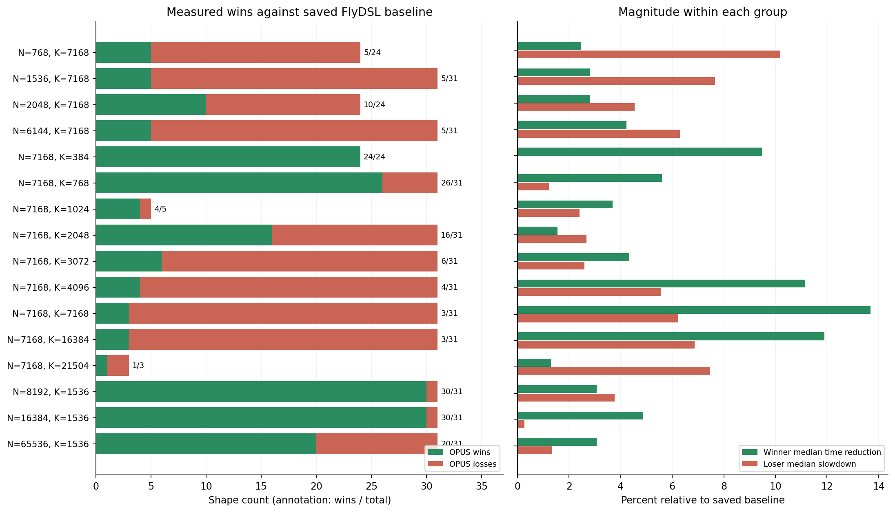

**gfx950 / 256 CU / A 1×128、B 128×128 scales：421 个 shape 的 tune 分析**

数据来自 2026-10-28 16:24–21:34 UTC 的 8 卡 tune；本分析于 2026-10-29 根据保存结果、CO 恢复前的 registry、构建报告和 tuner 源码生成。未进行新的 GPU 复测。

**当前更新：** build-co 已恢复 11 个因资源策略被拒绝的候选，可用 CO 为 262 个，补 PAD 的六种组合均可用。下面的耗时和覆盖数据仍是恢复前的快照；筛选现已支持默认 Top8 和全量模式，见 [CPU 优化记录](cpu_search_optimization_zh.md)。恢复详情见 [build-co 分析](build_co_analysis_zh.md)，继续工作见 [后续步骤](next_steps_zh.md)。

**先明确比较口径。** 原始完整结果没有“201 个胜出”这个统计：OPUS 胜过保存的 FlyDSL 基线 192 个，胜过本轮 FlyDSL 最快候选 207 个；旧 CSV 选择 OPUS 的 243 个中，本次比旧 OPUS 耗时更低的是 200 个。

“领先百分比”统一指耗时降低：`(参考耗时 − OPUS耗时) / 参考耗时 × 100%`。加速倍数为 `参考耗时 / OPUS耗时`。落后百分比为 `OPUS耗时 / 参考耗时 − 1`，两者均使用参考耗时作为分母。

**胜出领先多少。** 保存基线的 192 个胜出项：平均耗时降低 5.9903%，中位数 4.0948%，最小 0.0285%，最大 22.4457%。这不是模型端到端提升，也不是用调用频率加权的统计。

| 比较对象 | 胜出数 | 落后数 | 平均领先% | 中位领先% | 最小领先% | 最大领先% |
| --- | --- | --- | --- | --- | --- | --- |
| 保存基线 | 192 | 229 | 5.9903 | 4.0948 | 0.0285 | 22.4457 |
| 本轮FlyDSL | 207 | 214 | 6.6180 | 4.6996 | 0.0058 | 22.3844 |

| 耗时领先幅度（左闭右开） | 保存基线胜出数 | 同轮胜出数 |
| --- | --- | --- |
| 0～1% | 18 | 15 |
| 1～3% | 56 | 52 |
| 3～5% | 34 | 44 |
| 5～10% | 43 | 47 |
| 10～20% | 39 | 43 |
| 20%以上 | 2 | 6 |

完整逐项数据：[192 个基线胜出](baseline_wins_192.csv)、[207 个同轮胜出](fresh_wins_207.csv)、[200 个相对旧 OPUS 提升](old_opus_improvements_200.csv)。每条都有 M/N/K、基线与 OPUS 耗时、领先百分比、节省微秒数、加速倍数和 kernel。

**落后在哪里。** 相对保存基线的 229 个落后项，中位数慢 5.4491%，最差慢 17.8405%；102 个慢 5% 以内、100 个慢 5～10%、27 个慢 10～20%。其中 18 个实际胜过本轮 FlyDSL，其余 211 个在本轮比较中也更慢。

| N | K | 总数 | 胜出 | 落后 | 胜出中位领先% | 落后中位慢% | 最差慢% |
| --- | --- | --- | --- | --- | --- | --- | --- |
| 768 | 7168 | 24 | 5 | 19 | 2.4738 | 10.1903 | 17.8405 |
| 1536 | 7168 | 31 | 5 | 26 | 2.8017 | 7.6545 | 13.6467 |
| 2048 | 7168 | 24 | 10 | 14 | 2.8249 | 4.5349 | 13.4752 |
| 6144 | 7168 | 31 | 5 | 26 | 4.2219 | 6.2925 | 9.0848 |
| 7168 | 384 | 24 | 24 | 0 | 9.4711 | — | — |
| 7168 | 768 | 31 | 26 | 5 | 5.5955 | 1.2166 | 5.4768 |
| 7168 | 1024 | 5 | 4 | 1 | 3.6892 | 2.4134 | 2.4134 |
| 7168 | 2048 | 31 | 16 | 15 | 1.5448 | 2.6711 | 9.2139 |
| 7168 | 3072 | 31 | 6 | 25 | 4.3355 | 2.5955 | 9.5969 |
| 7168 | 4096 | 31 | 4 | 27 | 11.1576 | 5.5651 | 8.9328 |
| 7168 | 7168 | 31 | 3 | 28 | 13.6878 | 6.2361 | 8.9721 |
| 7168 | 16384 | 31 | 3 | 28 | 11.8901 | 6.8639 | 13.6328 |
| 7168 | 21504 | 3 | 1 | 2 | 1.3043 | 7.4543 | 8.2230 |
| 8192 | 1536 | 31 | 30 | 1 | 3.0728 | 3.7593 | 3.7593 |
| 16384 | 1536 | 31 | 30 | 1 | 4.8693 | 0.2754 | 0.2754 |
| 65536 | 1536 | 31 | 20 | 11 | 3.0626 | 1.3308 | 4.7034 |

**原因一：Top4 截断造成了可确认的候选遗漏。** 这轮 OPUS 测了 102,961 个候选与 shape 组合；按当前 registry 的合法性和等价配置去重，完整空间是 682,048 个，覆盖约 15.10%。418/421 个 shape 存在未测合法几何；229 个落后项中有 227 个。

其中 22 个落后 shape 的旧 OPUS 几何仍然合法，但此次没有测该几何中的任何候选。旧 243 个 OPUS 中，比旧记录更慢的 43 个里有 14 个属于这个情况。以上集合重叠，不能相加，也不能推断补测后一定超过基线。

具体例子 `(1792,768,7168)`：旧 OPUS 为 21.5670 μs，本次为 24.7703 μs，比旧记录慢 14.8528%，比保存基线 21.2933 μs 慢 16.3291%。旧几何 BM=48、BN=128、BK=256、wave=1×4 当前有 48 个合法配置，本次测了 0 个。该 shape 本次总共只测了 17/76 种合法几何。

机制是 tuner 的 `opus_candidates(top_geometries=4)` 按 pipeline 只保留评分前四种几何。历史结果中的 OPUS seeds 可以绕过截断；此次恢复后的输入和配置是纯 FlyDSL，tune.log 的 OPUS search 全部 seeds=0。配置编号已变，恢复旧 seed 应按 kernel 配置参数映射当前 kid，不能直接搬旧数字。

**原因二：原 tune 时 pin 候选的资源限制与调度范围。** 115/229 个落后 shape 的最佳 OPUS 是 4wave_pin_agpr，其中 20 个 M 不是 256 的倍数。原构建报告中，非 pad 路径仅 sp16/sp32/sp64、u2 可用，LDS 分别为 139,392 / 143,616 / 152,064 bytes；pad 路径仅 sp16/u2 可用，sp32/sp64 因 SGPR spill 被拒绝。所有 u4 组合也被 spill 检查拒绝。有效 kernel 本身不是带 spill 上线跑的；被拒绝的是可搜索候选。

当前 manifest 对这条 pipeline 使用运行时 K、GroupM=0、默认 LDS 输出和固定 256×256×128 几何。旧候选曾有 GroupM=4/8/16、不同输出和固定 K 版本；源代码 traits 仍支持 GroupM 与输出变化。这些范围变化和高 LDS 占用，是后续针对长 K 的明确实验方向。高 LDS、寄存器压力、等待/同步与缓存复用对实测差距各占多少，现有结果不能单独判定，需要 profiling。

**原因三：N 较窄、K 较长时需要重新平衡 tile/wave/预取。** N=768、1536、2048，K=7168 三组共有 59 个落后；其中 N=768 落后中位数 10.1903%，N=1536 为 7.6545%。应先补回未测的 BN=128 几何，再比较 BN=64/128、2/4 wave、stage=2/3/4 和 B 预取距离。现有几何评分只估 padding、workgroup 数量和 tile 尺寸，未覆盖矩阵复用、LDS/寄存器资源和实际指令开销；仅由 shape 和耗时不能确认是带宽瓶颈还是 MFMA/依赖等待瓶颈。

**原因四：少量比较受基线批次差异影响。** 18 个保存基线落后项胜过本轮 FlyDSL；本轮 FlyDSL 相对保存基线的耗时差中位数为 +0.9344%。它可能来自测量条件或选中候选变化。192 个胜出中有 74 个领先不足 3%，229 个落后中有 59 个慢不足 3%，应优先用同卡、同输入轮换方式做交替重复测量，不把 3% 当成已测得的噪声边界。

**建议的优化顺序。**

1. 修改 tuner：增加 `--opus_top_geometries`，`0` 表示不截断，正整数保留 TopN；优先对 22 个漏测旧几何的落后项补测，再覆盖其余落后项。保留 shape 合法性检查。该参数已在 CPU 阶段实现，默认 Top8，0 保留全部；见 [CPU 优化记录](cpu_search_optimization_zh.md)。完整 OPUS 候选测量数约为本次的 6.62 倍，建议分阶段补齐，已有 192 个胜出优先留作回归集。

2. 补测应同时保留保存基线的确切 FlyDSL kernel、本轮 FlyDSL 最快候选和旧 OPUS 的等价配置。每个 shape 的前 3～5 个候选做至少 5 轮交替测量，以中位数和离散度确认最终排序；101 次迭代得到的单轮平均值不能代替跨轮稳定性。

3. N 窄、K=7168 的组先解决几何覆盖。对仍慢的代表项采集 MFMA 活跃度、memory/LDS wait、实际驻留 wave 和寄存器/共享内存资源，再决定调 stage、B 预取或缓存路径。

4. build-co 已按 gfx1250 的默认资源策略恢复候选；所有恢复项已通过 pin 校验，数值和性能尚未复测。优先验证 PAD 的 sp32/64、u2/u4，它们没有 VGPR spill/scratch。对大量 VGPR spill 的 sp16/u4 单独评估，再考虑缩短寄存器活跃区间。4wave 的 GroupM=0/4/8/16 和输出方式留作后续有限枚举。

5. 优先研究大 M 的 `(N,K)=(7168,16384)、(7168,7168)、(6144,7168)、(7168,4096)`。例如 `(65536,7168,16384)` 的 OPUS 为 5589.2283 μs，基线为 5355.0470 μs，虽只慢 4.3731%，绝对多了 234.1813 μs。最终排序应用实际调用频率乘以单次 gap；这里没有调用频率，不能据此宣称模型端到端收益。

**本次输出。** [全部 421 个 shape](all_shapes_421.csv)、[229 个落后项及证据/建议](baseline_losses_229_with_evidence.csv)、[候选覆盖](candidate_coverage_421.csv)、[各 pipeline 实测最佳结果](best_measured_by_pipeline.csv)、[按 N/K 分组](summary_by_nk.csv)、[汇总 JSON](summary.json)。本次完成分析和数据导出，build-co 资源策略和可配置几何筛选已实现，m_repeat JIT 已追加分组及大 panel 候选；性能统计保持原测量快照，未新增 GPU 复测。

**192 个保存基线胜出项逐条明细（按领先幅度排序）。**

| M | N | K | 基线μs | OPUSμs | 领先% | 节省μs | 加速倍数 |
| --- | --- | --- | --- | --- | --- | --- | --- |
| 1152 | 16384 | 1536 | 43.9194 | 34.0614 | 22.4457 | 9.8580 | 1.2894 |
| 1088 | 16384 | 1536 | 41.9882 | 33.2262 | 20.8678 | 8.7620 | 1.2637 |
| 1088 | 7168 | 3072 | 33.7513 | 27.2705 | 19.2016 | 6.4808 | 1.2376 |
| 1088 | 7168 | 2048 | 23.6565 | 19.1158 | 19.1943 | 4.5407 | 1.2375 |
| 1088 | 7168 | 4096 | 42.5246 | 34.3869 | 19.1365 | 8.1377 | 1.2367 |
| 1152 | 7168 | 4096 | 43.2634 | 35.0042 | 19.0905 | 8.2592 | 1.2359 |
| 1152 | 7168 | 2048 | 23.5266 | 19.2777 | 18.0600 | 4.2489 | 1.2204 |
| 1664 | 7168 | 384 | 12.1987 | 10.0110 | 17.9339 | 2.1877 | 1.2185 |
| 1152 | 7168 | 3072 | 33.6321 | 27.6613 | 17.7533 | 5.9708 | 1.2159 |
| 1536 | 7168 | 384 | 11.5754 | 9.6222 | 16.8737 | 1.9532 | 1.2030 |
| 1344 | 7168 | 384 | 10.9430 | 9.1126 | 16.7267 | 1.8304 | 1.2009 |
| 1472 | 7168 | 384 | 11.2290 | 9.3987 | 16.2998 | 1.8303 | 1.1947 |
| 1344 | 8192 | 1536 | 25.2033 | 21.1054 | 16.2594 | 4.0979 | 1.1942 |
| 1152 | 7168 | 7168 | 69.8912 | 58.9390 | 15.6704 | 10.9522 | 1.1858 |
| 1664 | 7168 | 768 | 16.1468 | 13.6249 | 15.6186 | 2.5219 | 1.1851 |
| 1600 | 7168 | 384 | 11.5338 | 9.7605 | 15.3748 | 1.7733 | 1.1817 |
| 1728 | 7168 | 384 | 11.9785 | 10.1498 | 15.2665 | 1.8287 | 1.1802 |
| 1536 | 16384 | 1536 | 51.5715 | 44.0563 | 14.5724 | 7.5152 | 1.1706 |
| 1280 | 7168 | 768 | 15.1916 | 13.0379 | 14.1769 | 2.1537 | 1.1652 |
| 1088 | 7168 | 7168 | 69.2076 | 59.7346 | 13.6878 | 9.4730 | 1.1586 |
| 1280 | 7168 | 384 | 10.4175 | 8.9999 | 13.6079 | 1.4176 | 1.1575 |
| 1152 | 7168 | 16384 | 144.4897 | 124.9136 | 13.5484 | 19.5761 | 1.1567 |
| 10240 | 7168 | 384 | 53.8592 | 46.5843 | 13.5073 | 7.2749 | 1.1562 |
| 1216 | 8192 | 1536 | 24.3456 | 21.0741 | 13.4377 | 3.2715 | 1.1552 |
| 1408 | 7168 | 384 | 10.7004 | 9.2864 | 13.2145 | 1.4140 | 1.1523 |
| 1344 | 7168 | 768 | 15.2228 | 13.2265 | 13.1139 | 1.9963 | 1.1509 |
| 1728 | 7168 | 768 | 15.9063 | 13.8534 | 12.9062 | 2.0529 | 1.1482 |
| 1152 | 7168 | 768 | 13.1716 | 11.4811 | 12.8344 | 1.6905 | 1.1472 |
| 1536 | 8192 | 1536 | 26.0801 | 22.8229 | 12.4892 | 3.2572 | 1.1427 |
| 1472 | 8192 | 1536 | 25.4328 | 22.3005 | 12.3160 | 3.1323 | 1.1405 |
| 1408 | 7168 | 768 | 15.2715 | 13.4210 | 12.1173 | 1.8505 | 1.1379 |
| 1088 | 7168 | 16384 | 139.7252 | 123.1117 | 11.8901 | 16.6135 | 1.1349 |
| 1216 | 16384 | 1536 | 45.7927 | 40.4539 | 11.6586 | 5.3388 | 1.1320 |
| 1088 | 7168 | 768 | 12.8667 | 11.3979 | 11.4155 | 1.4688 | 1.1289 |
| 1472 | 16384 | 1536 | 49.5007 | 43.8803 | 11.3542 | 5.6204 | 1.1281 |
| 1536 | 7168 | 768 | 15.3371 | 13.6321 | 11.1168 | 1.7050 | 1.1251 |
| 1216 | 7168 | 384 | 9.9901 | 8.8820 | 11.0920 | 1.1081 | 1.1248 |
| 8192 | 7168 | 384 | 43.7859 | 39.1626 | 10.5589 | 4.6233 | 1.1181 |
| 1344 | 16384 | 1536 | 47.3463 | 42.3599 | 10.5318 | 4.9864 | 1.1177 |
| 1600 | 7168 | 768 | 15.1905 | 13.6123 | 10.3894 | 1.5782 | 1.1159 |
| 1216 | 7168 | 768 | 14.3595 | 12.9074 | 10.1125 | 1.4521 | 1.1125 |
| 14336 | 7168 | 384 | 70.4906 | 63.7272 | 9.5948 | 6.7634 | 1.1061 |
| 4096 | 65536 | 1536 | 444.4196 | 402.7986 | 9.3652 | 41.6210 | 1.1033 |
| 16384 | 7168 | 384 | 80.0375 | 72.5561 | 9.3474 | 7.4814 | 1.1031 |
| 1088 | 7168 | 384 | 9.5046 | 8.6362 | 9.1366 | 0.8684 | 1.1006 |
| 1472 | 7168 | 768 | 14.9451 | 13.5930 | 9.0471 | 1.3521 | 1.0995 |
| 4096 | 7168 | 384 | 24.2970 | 22.1356 | 8.8957 | 2.1614 | 1.0976 |
| 32768 | 7168 | 384 | 152.9863 | 139.4351 | 8.8578 | 13.5512 | 1.0972 |
| 12288 | 7168 | 384 | 60.3001 | 55.0439 | 8.7167 | 5.2562 | 1.0955 |
| 1152 | 8192 | 1536 | 22.6420 | 20.6732 | 8.6953 | 1.9688 | 1.0952 |
| 1408 | 1536 | 7168 | 29.5940 | 27.0227 | 8.6886 | 2.5713 | 1.0952 |
| 1152 | 7168 | 384 | 9.5697 | 8.7751 | 8.3033 | 0.7946 | 1.0906 |
| 6144 | 7168 | 384 | 32.5326 | 29.9859 | 7.8281 | 2.5467 | 1.0849 |
| 4096 | 8192 | 1536 | 59.1893 | 54.5628 | 7.8164 | 4.6265 | 1.0848 |
| 8192 | 8192 | 1536 | 112.1166 | 103.6722 | 7.5318 | 8.4444 | 1.0815 |
| 2048 | 65536 | 1536 | 223.6398 | 206.8266 | 7.5180 | 16.8132 | 1.0813 |
| 1856 | 7168 | 384 | 13.2375 | 12.2658 | 7.3405 | 0.9717 | 1.0792 |
| 2048 | 8192 | 1536 | 30.1853 | 27.9779 | 7.3128 | 2.2074 | 1.0789 |
| 1792 | 2048 | 7168 | 39.3282 | 36.4827 | 7.2353 | 2.8455 | 1.0780 |
| 1920 | 16384 | 1536 | 57.7812 | 53.7389 | 6.9959 | 4.0423 | 1.0752 |
| 6144 | 65536 | 1536 | 640.5107 | 595.9492 | 6.9572 | 44.5615 | 1.0748 |
| 1728 | 16384 | 1536 | 54.9800 | 51.3124 | 6.6708 | 3.6676 | 1.0715 |
| 1984 | 7168 | 384 | 13.8102 | 12.9233 | 6.4221 | 0.8869 | 1.0686 |
| 1792 | 7168 | 384 | 13.1225 | 12.2845 | 6.3860 | 0.8380 | 1.0682 |
| 1408 | 16384 | 1536 | 48.6291 | 45.5410 | 6.3503 | 3.0881 | 1.0678 |
| 1728 | 7168 | 3072 | 43.2722 | 40.5991 | 6.1774 | 2.6731 | 1.0658 |
| 6144 | 7168 | 768 | 48.9591 | 45.9979 | 6.0483 | 2.9612 | 1.0644 |
| 16384 | 16384 | 1536 | 413.3965 | 388.8974 | 5.9263 | 24.4991 | 1.0630 |
| 1856 | 16384 | 1536 | 55.8532 | 52.5668 | 5.8840 | 3.2864 | 1.0625 |
| 2048 | 7168 | 384 | 13.8804 | 13.0698 | 5.8399 | 0.8106 | 1.0620 |
| 4096 | 7168 | 768 | 33.3285 | 31.3953 | 5.8004 | 1.9332 | 1.0616 |
| 1984 | 1536 | 7168 | 31.6749 | 29.8809 | 5.6638 | 1.7940 | 1.0600 |
| 1216 | 6144 | 7168 | 66.3638 | 62.6417 | 5.6086 | 3.7221 | 1.0594 |
| 57344 | 16384 | 1536 | 1429.0397 | 1350.1622 | 5.5196 | 78.8775 | 1.0584 |
| 1792 | 16384 | 1536 | 54.9228 | 51.9612 | 5.3923 | 2.9616 | 1.0570 |
| 2048 | 7168 | 768 | 18.4098 | 17.4174 | 5.3906 | 0.9924 | 1.0570 |
| 6144 | 8192 | 1536 | 84.3691 | 79.8351 | 5.3740 | 4.5340 | 1.0568 |
| 1792 | 65536 | 1536 | 195.5299 | 185.1298 | 5.3189 | 10.4001 | 1.0562 |
| 12288 | 65536 | 1536 | 1235.7255 | 1170.0452 | 5.3151 | 65.6803 | 1.0561 |
| 1984 | 8192 | 1536 | 29.2993 | 27.7658 | 5.2339 | 1.5335 | 1.0552 |
| 1600 | 16384 | 1536 | 53.2227 | 50.4956 | 5.1239 | 2.7271 | 1.0540 |
| 1792 | 7168 | 768 | 17.3524 | 16.4751 | 5.0558 | 0.8773 | 1.0533 |
| 1920 | 7168 | 384 | 13.4600 | 12.7830 | 5.0297 | 0.6770 | 1.0530 |
| 1280 | 16384 | 1536 | 46.3067 | 43.9875 | 5.0083 | 2.3192 | 1.0527 |
| 14336 | 7168 | 2048 | 198.5352 | 189.0514 | 4.7769 | 9.4838 | 1.0502 |
| 4096 | 16384 | 1536 | 110.7033 | 105.4668 | 4.7302 | 5.2365 | 1.0497 |
| 1856 | 2048 | 7168 | 39.0150 | 37.1811 | 4.7005 | 1.8339 | 1.0493 |
| 1152 | 6144 | 7168 | 64.4310 | 61.4697 | 4.5961 | 2.9613 | 1.0482 |
| 2048 | 2048 | 7168 | 40.6944 | 38.8450 | 4.5446 | 1.8494 | 1.0476 |
| 1472 | 2048 | 7168 | 31.5492 | 30.1622 | 4.3963 | 1.3870 | 1.0460 |
| 1344 | 768 | 7168 | 18.5508 | 17.7452 | 4.3427 | 0.8056 | 1.0454 |
| 1536 | 65536 | 1536 | 164.7527 | 157.6467 | 4.3131 | 7.1060 | 1.0451 |
| 28672 | 8192 | 1536 | 359.6482 | 344.1493 | 4.3095 | 15.4989 | 1.0450 |
| 1088 | 6144 | 7168 | 63.1582 | 60.4917 | 4.2219 | 2.6665 | 1.0441 |
| 2048 | 16384 | 1536 | 57.6724 | 55.2557 | 4.1904 | 2.4167 | 1.0437 |
| 8192 | 65536 | 1536 | 830.9034 | 796.8131 | 4.1028 | 34.0903 | 1.0428 |
| 16384 | 7168 | 1024 | 133.4608 | 128.0066 | 4.0867 | 5.4542 | 1.0426 |
| 1280 | 6144 | 7168 | 66.3123 | 63.6085 | 4.0774 | 2.7038 | 1.0425 |
| 14336 | 65536 | 1536 | 1424.6356 | 1366.5555 | 4.0768 | 58.0801 | 1.0425 |
| 49152 | 16384 | 1536 | 1207.5805 | 1159.2102 | 4.0056 | 48.3703 | 1.0417 |
| 32768 | 16384 | 1536 | 807.4846 | 775.3515 | 3.9794 | 32.1331 | 1.0414 |
| 40960 | 16384 | 1536 | 1007.9169 | 968.7966 | 3.8813 | 39.1203 | 1.0404 |
| 1856 | 8192 | 1536 | 28.5018 | 27.4137 | 3.8177 | 1.0881 | 1.0397 |
| 16384 | 8192 | 1536 | 209.0681 | 201.1127 | 3.8052 | 7.9554 | 1.0396 |
| 4096 | 7168 | 1024 | 39.8022 | 38.3097 | 3.7498 | 1.4925 | 1.0390 |
| 1984 | 16384 | 1536 | 57.3916 | 55.2517 | 3.7286 | 2.1399 | 1.0387 |
| 1728 | 7168 | 2048 | 30.3549 | 29.2369 | 3.6831 | 1.1180 | 1.0382 |
| 12288 | 16384 | 1536 | 307.4157 | 296.2468 | 3.6332 | 11.1689 | 1.0377 |
| 2048 | 7168 | 1024 | 21.1484 | 20.3810 | 3.6286 | 0.7674 | 1.0377 |
| 1344 | 65536 | 1536 | 155.7390 | 150.1504 | 3.5884 | 5.5886 | 1.0372 |
| 10240 | 8192 | 1536 | 132.0153 | 127.4631 | 3.4482 | 4.5522 | 1.0357 |
| 8192 | 16384 | 1536 | 210.5119 | 203.5174 | 3.3226 | 6.9945 | 1.0344 |
| 57344 | 7168 | 768 | 380.5214 | 367.9543 | 3.3026 | 12.5671 | 1.0342 |
| 1728 | 7168 | 4096 | 54.4755 | 52.7188 | 3.2248 | 1.7567 | 1.0333 |
| 1216 | 65536 | 1536 | 137.5869 | 133.2511 | 3.1513 | 4.3358 | 1.0325 |
| 24576 | 8192 | 1536 | 306.6403 | 296.9990 | 3.1442 | 9.6413 | 1.0325 |
| 1984 | 768 | 7168 | 22.0587 | 21.3814 | 3.0704 | 0.6773 | 1.0317 |
| 12288 | 8192 | 1536 | 156.8155 | 152.1088 | 3.0014 | 4.7067 | 1.0309 |
| 1792 | 8192 | 1536 | 28.0325 | 27.1977 | 2.9780 | 0.8348 | 1.0307 |
| 1984 | 65536 | 1536 | 218.6374 | 212.1354 | 2.9739 | 6.5020 | 1.0307 |
| 1920 | 2048 | 7168 | 38.0772 | 36.9836 | 2.8721 | 1.0936 | 1.0296 |
| 1472 | 1536 | 7168 | 29.5824 | 28.7536 | 2.8017 | 0.8288 | 1.0288 |
| 1664 | 2048 | 7168 | 37.8586 | 36.8070 | 2.7777 | 1.0516 | 1.0286 |
| 1600 | 8192 | 1536 | 26.8249 | 26.0913 | 2.7348 | 0.7336 | 1.0281 |
| 14336 | 7168 | 768 | 100.0140 | 97.2800 | 2.7336 | 2.7340 | 1.0281 |
| 1408 | 8192 | 1536 | 25.5322 | 24.8421 | 2.7029 | 0.6901 | 1.0278 |
| 1088 | 65536 | 1536 | 130.3628 | 126.8554 | 2.6905 | 3.5074 | 1.0276 |
| 1984 | 2048 | 7168 | 39.0260 | 37.9830 | 2.6726 | 1.0430 | 1.0275 |
| 1152 | 65536 | 1536 | 134.0756 | 130.4950 | 2.6706 | 3.5806 | 1.0274 |
| 24576 | 16384 | 1536 | 609.7267 | 593.5255 | 2.6571 | 16.2012 | 1.0273 |
| 65536 | 8192 | 1536 | 795.3957 | 774.2799 | 2.6548 | 21.1158 | 1.0273 |
| 1536 | 2048 | 7168 | 32.2848 | 31.4296 | 2.6489 | 0.8552 | 1.0272 |
| 65536 | 16384 | 1536 | 1602.2627 | 1560.4877 | 2.6073 | 41.7750 | 1.0268 |
| 20480 | 8192 | 1536 | 257.5033 | 250.8819 | 2.5714 | 6.6214 | 1.0264 |
| 49152 | 8192 | 1536 | 600.3728 | 585.0192 | 2.5573 | 15.3536 | 1.0262 |
| 4096 | 7168 | 2048 | 64.6548 | 63.0044 | 2.5526 | 1.6504 | 1.0262 |
| 10240 | 65536 | 1536 | 1019.1127 | 993.6249 | 2.5010 | 25.4878 | 1.0257 |
| 14336 | 7168 | 3072 | 272.2069 | 265.4194 | 2.4935 | 6.7875 | 1.0256 |
| 1920 | 8192 | 1536 | 28.4065 | 27.7025 | 2.4783 | 0.7040 | 1.0254 |
| 32768 | 8192 | 1536 | 403.9822 | 393.9711 | 2.4781 | 10.0111 | 1.0254 |
| 4096 | 768 | 7168 | 36.2763 | 35.3789 | 2.4738 | 0.8974 | 1.0254 |
| 6144 | 16384 | 1536 | 156.2938 | 152.5837 | 2.3738 | 3.7101 | 1.0243 |
| 65536 | 7168 | 768 | 431.6796 | 421.7930 | 2.2903 | 9.8866 | 1.0234 |
| 40960 | 8192 | 1536 | 500.2703 | 489.6594 | 2.1210 | 10.6109 | 1.0217 |
| 49152 | 7168 | 768 | 325.9127 | 319.0462 | 2.1069 | 6.8665 | 1.0215 |
| 1280 | 65536 | 1536 | 138.2856 | 135.4112 | 2.0786 | 2.8744 | 1.0212 |
| 49152 | 7168 | 2048 | 622.9362 | 610.4194 | 2.0093 | 12.5168 | 1.0205 |
| 57344 | 8192 | 1536 | 698.1251 | 684.1451 | 2.0025 | 13.9800 | 1.0204 |
| 32768 | 7168 | 2048 | 427.3851 | 418.9448 | 1.9749 | 8.4403 | 1.0201 |
| 1280 | 8192 | 1536 | 24.8457 | 24.3756 | 1.8921 | 0.4701 | 1.0193 |
| 1728 | 65536 | 1536 | 187.6031 | 184.2014 | 1.8132 | 3.4017 | 1.0185 |
| 20480 | 7168 | 768 | 138.6235 | 136.1645 | 1.7739 | 2.4590 | 1.0181 |
| 14336 | 8192 | 1536 | 178.8494 | 175.6863 | 1.7686 | 3.1631 | 1.0180 |
| 16384 | 7168 | 2048 | 218.3423 | 214.6176 | 1.7059 | 3.7247 | 1.0174 |
| 14336 | 7168 | 16384 | 1250.0499 | 1228.8975 | 1.6921 | 21.1524 | 1.0172 |
| 1472 | 768 | 7168 | 20.4688 | 20.1273 | 1.6684 | 0.3415 | 1.0170 |
| 40960 | 7168 | 768 | 271.7604 | 267.5269 | 1.5578 | 4.2335 | 1.0158 |
| 2048 | 7168 | 3072 | 46.0346 | 45.3420 | 1.5045 | 0.6926 | 1.0153 |
| 1728 | 8192 | 1536 | 26.9925 | 26.5891 | 1.4945 | 0.4034 | 1.0152 |
| 28672 | 16384 | 1536 | 689.3637 | 679.0991 | 1.4890 | 10.2646 | 1.0151 |
| 10240 | 16384 | 1536 | 253.7539 | 249.9960 | 1.4809 | 3.7579 | 1.0150 |
| 1344 | 1536 | 7168 | 25.6312 | 25.2530 | 1.4755 | 0.3782 | 1.0150 |
| 12288 | 7168 | 2048 | 170.9072 | 168.5424 | 1.3837 | 2.3648 | 1.0140 |
| 40960 | 7168 | 2048 | 525.2001 | 518.0159 | 1.3679 | 7.1842 | 1.0139 |
| 3072 | 7168 | 21504 | 416.2038 | 410.7753 | 1.3043 | 5.4285 | 1.0132 |
| 1664 | 8192 | 1536 | 26.9031 | 26.5609 | 1.2720 | 0.3422 | 1.0129 |
| 1664 | 16384 | 1536 | 53.5887 | 52.9139 | 1.2592 | 0.6748 | 1.0128 |
| 12288 | 1536 | 7168 | 146.1496 | 144.4583 | 1.1572 | 1.6913 | 1.0117 |
| 1920 | 7168 | 2048 | 32.3313 | 31.9581 | 1.1543 | 0.3732 | 1.0117 |
| 24576 | 7168 | 2048 | 322.6568 | 318.9703 | 1.1425 | 3.6865 | 1.0116 |
| 65536 | 7168 | 2048 | 825.7012 | 816.6011 | 1.1021 | 9.1001 | 1.0111 |
| 28672 | 7168 | 2048 | 368.9144 | 364.9939 | 1.0627 | 3.9205 | 1.0107 |
| 1408 | 768 | 7168 | 19.1262 | 18.9310 | 1.0206 | 0.1952 | 1.0103 |
| 32768 | 7168 | 1024 | 258.1505 | 255.5479 | 1.0082 | 2.6026 | 1.0102 |
| 16384 | 7168 | 768 | 112.3060 | 111.1874 | 0.9960 | 1.1186 | 1.0101 |
| 14336 | 7168 | 4096 | 343.1458 | 339.8528 | 0.9597 | 3.2930 | 1.0097 |
| 4096 | 7168 | 3072 | 88.8926 | 88.1141 | 0.8758 | 0.7785 | 1.0088 |
| 20480 | 65536 | 1536 | 2042.7904 | 2025.8845 | 0.8276 | 16.9059 | 1.0083 |
| 14336 | 7168 | 7168 | 565.2609 | 560.7446 | 0.7990 | 4.5163 | 1.0081 |
| 20480 | 16384 | 1536 | 496.4196 | 492.7675 | 0.7357 | 3.6521 | 1.0074 |
| 32768 | 65536 | 1536 | 3263.5129 | 3240.8676 | 0.6939 | 22.6453 | 1.0070 |
| 1728 | 2048 | 7168 | 37.3510 | 37.1172 | 0.6260 | 0.2338 | 1.0063 |
| 28672 | 65536 | 1536 | 2856.1631 | 2838.6990 | 0.6115 | 17.4641 | 1.0062 |
| 28672 | 7168 | 768 | 189.6152 | 188.4896 | 0.5936 | 1.1256 | 1.0060 |
| 1600 | 2048 | 7168 | 36.9542 | 36.7430 | 0.5715 | 0.2112 | 1.0057 |
| 4096 | 6144 | 7168 | 162.9080 | 162.1451 | 0.4683 | 0.7629 | 1.0047 |
| 10240 | 7168 | 768 | 73.2037 | 72.8622 | 0.4665 | 0.3415 | 1.0047 |
| 57344 | 7168 | 2048 | 729.5345 | 726.2002 | 0.4570 | 3.3343 | 1.0046 |
| 1472 | 65536 | 1536 | 160.0777 | 159.5497 | 0.3298 | 0.5280 | 1.0033 |
| 32768 | 7168 | 768 | 215.0880 | 214.4515 | 0.2959 | 0.6365 | 1.0030 |
| 1856 | 7168 | 768 | 17.3065 | 17.2672 | 0.2271 | 0.0393 | 1.0023 |
| 1856 | 7168 | 2048 | 32.2993 | 32.2901 | 0.0285 | 0.0092 | 1.0003 |

**207 个同轮 FlyDSL 胜出项逐条明细（按领先幅度排序）。**

| M | N | K | 同轮FlyDSLμs | OPUSμs | 领先% | 节省μs | 加速倍数 |
| --- | --- | --- | --- | --- | --- | --- | --- |
| 1472 | 7168 | 384 | 12.1093 | 9.3987 | 22.3844 | 2.7106 | 1.2884 |
| 1088 | 16384 | 1536 | 42.1919 | 33.2262 | 21.2498 | 8.9657 | 1.2698 |
| 1536 | 7168 | 384 | 12.1316 | 9.6222 | 20.6848 | 2.5094 | 1.2608 |
| 1664 | 7168 | 384 | 12.6061 | 10.0110 | 20.5861 | 2.5951 | 1.2592 |
| 1600 | 7168 | 384 | 12.2481 | 9.7605 | 20.3101 | 2.4876 | 1.2549 |
| 1152 | 16384 | 1536 | 42.6547 | 34.0614 | 20.1462 | 8.5933 | 1.2523 |
| 1152 | 7168 | 4096 | 43.7167 | 35.0042 | 19.9295 | 8.7125 | 1.2489 |
| 1088 | 7168 | 4096 | 42.9091 | 34.3869 | 19.8611 | 8.5222 | 1.2478 |
| 1728 | 7168 | 384 | 12.6438 | 10.1498 | 19.7251 | 2.4940 | 1.2457 |
| 1152 | 7168 | 2048 | 23.9625 | 19.2777 | 19.5505 | 4.6848 | 1.2430 |
| 1344 | 7168 | 384 | 11.3167 | 9.1126 | 19.4765 | 2.2041 | 1.2419 |
| 1280 | 7168 | 384 | 11.0342 | 8.9999 | 18.4363 | 2.0343 | 1.2260 |
| 1408 | 7168 | 384 | 11.3545 | 9.2864 | 18.2139 | 2.0681 | 1.2227 |
| 1152 | 7168 | 3072 | 33.8022 | 27.6613 | 18.1672 | 6.1409 | 1.2220 |
| 1088 | 7168 | 2048 | 23.1855 | 19.1158 | 17.5528 | 4.0697 | 1.2129 |
| 1088 | 7168 | 3072 | 33.0022 | 27.2705 | 17.3676 | 5.7317 | 1.2102 |
| 1280 | 7168 | 768 | 15.5817 | 13.0379 | 16.3256 | 2.5438 | 1.1951 |
| 1600 | 7168 | 768 | 16.2574 | 13.6123 | 16.2701 | 2.6451 | 1.1943 |
| 1152 | 7168 | 768 | 13.6959 | 11.4811 | 16.1713 | 2.2148 | 1.1929 |
| 1088 | 7168 | 7168 | 70.9539 | 59.7346 | 15.8121 | 11.2193 | 1.1878 |
| 1344 | 8192 | 1536 | 25.0506 | 21.1054 | 15.7489 | 3.9452 | 1.1869 |
| 1152 | 7168 | 16384 | 148.1582 | 124.9136 | 15.6890 | 23.2446 | 1.1861 |
| 1472 | 7168 | 768 | 16.1191 | 13.5930 | 15.6715 | 2.5261 | 1.1858 |
| 1728 | 7168 | 768 | 16.3722 | 13.8534 | 15.3846 | 2.5188 | 1.1818 |
| 1152 | 7168 | 7168 | 69.5695 | 58.9390 | 15.2804 | 10.6305 | 1.1804 |
| 1088 | 7168 | 16384 | 145.3133 | 123.1117 | 15.2784 | 22.2016 | 1.1803 |
| 1536 | 7168 | 768 | 16.0808 | 13.6321 | 15.2275 | 2.4487 | 1.1796 |
| 1088 | 7168 | 768 | 13.3826 | 11.3979 | 14.8305 | 1.9847 | 1.1741 |
| 1472 | 16384 | 1536 | 51.4376 | 43.8803 | 14.6922 | 7.5573 | 1.1722 |
| 1408 | 7168 | 768 | 15.7126 | 13.4210 | 14.5845 | 2.2916 | 1.1707 |
| 1472 | 8192 | 1536 | 26.1065 | 22.3005 | 14.5787 | 3.8060 | 1.1707 |
| 1536 | 8192 | 1536 | 26.6701 | 22.8229 | 14.4251 | 3.8472 | 1.1686 |
| 1536 | 16384 | 1536 | 51.3772 | 44.0563 | 14.2493 | 7.3209 | 1.1662 |
| 1216 | 8192 | 1536 | 24.5707 | 21.0741 | 14.2308 | 3.4966 | 1.1659 |
| 1344 | 7168 | 768 | 15.3469 | 13.2265 | 13.8165 | 2.1204 | 1.1603 |
| 1216 | 7168 | 384 | 10.2877 | 8.8820 | 13.6639 | 1.4057 | 1.1583 |
| 1216 | 7168 | 768 | 14.8947 | 12.9074 | 13.3423 | 1.9873 | 1.1540 |
| 10240 | 7168 | 384 | 53.7327 | 46.5843 | 13.3036 | 7.1484 | 1.1535 |
| 1088 | 7168 | 384 | 9.9603 | 8.6362 | 13.2938 | 1.3241 | 1.1533 |
| 1664 | 7168 | 768 | 15.6937 | 13.6249 | 13.1824 | 2.0688 | 1.1518 |
| 6144 | 7168 | 384 | 34.0342 | 29.9859 | 11.8948 | 4.0483 | 1.1350 |
| 1152 | 7168 | 384 | 9.9125 | 8.7751 | 11.4744 | 1.1374 | 1.1296 |
| 1152 | 8192 | 1536 | 23.3305 | 20.6732 | 11.3898 | 2.6573 | 1.1285 |
| 14336 | 7168 | 384 | 71.6997 | 63.7272 | 11.1193 | 7.9725 | 1.1251 |
| 12288 | 7168 | 384 | 61.6528 | 55.0439 | 10.7195 | 6.6089 | 1.1201 |
| 1216 | 16384 | 1536 | 45.2023 | 40.4539 | 10.5048 | 4.7484 | 1.1174 |
| 16384 | 7168 | 384 | 80.8866 | 72.5561 | 10.2990 | 8.3305 | 1.1148 |
| 1344 | 16384 | 1536 | 47.0968 | 42.3599 | 10.0578 | 4.7369 | 1.1118 |
| 2048 | 7168 | 384 | 14.5237 | 13.0698 | 10.0105 | 1.4539 | 1.1112 |
| 8192 | 7168 | 384 | 43.5122 | 39.1626 | 9.9963 | 4.3496 | 1.1111 |
| 32768 | 7168 | 384 | 154.4189 | 139.4351 | 9.7033 | 14.9838 | 1.1075 |
| 1408 | 16384 | 1536 | 50.1368 | 45.5410 | 9.1665 | 4.5958 | 1.1009 |
| 4096 | 65536 | 1536 | 442.5947 | 402.7986 | 8.9915 | 39.7961 | 1.0988 |
| 1792 | 7168 | 768 | 18.0598 | 16.4751 | 8.7747 | 1.5847 | 1.0962 |
| 4096 | 8192 | 1536 | 59.5369 | 54.5628 | 8.3547 | 4.9741 | 1.0912 |
| 1792 | 7168 | 384 | 13.3971 | 12.2845 | 8.3048 | 1.1126 | 1.0906 |
| 1152 | 6144 | 7168 | 66.8049 | 61.4697 | 7.9862 | 5.3352 | 1.0868 |
| 8192 | 8192 | 1536 | 112.6391 | 103.6722 | 7.9607 | 8.9669 | 1.0865 |
| 2048 | 65536 | 1536 | 224.7114 | 206.8266 | 7.9590 | 17.8848 | 1.0865 |
| 1920 | 7168 | 384 | 13.8859 | 12.7830 | 7.9426 | 1.1029 | 1.0863 |
| 1408 | 1536 | 7168 | 29.3157 | 27.0227 | 7.8217 | 2.2930 | 1.0849 |
| 1984 | 7168 | 384 | 14.0140 | 12.9233 | 7.7829 | 1.0907 | 1.0844 |
| 4096 | 7168 | 1024 | 41.4734 | 38.3097 | 7.6283 | 3.1637 | 1.0826 |
| 1856 | 7168 | 384 | 13.2496 | 12.2658 | 7.4251 | 0.9838 | 1.0802 |
| 4096 | 7168 | 768 | 33.8865 | 31.3953 | 7.3516 | 2.4912 | 1.0793 |
| 1856 | 16384 | 1536 | 56.5689 | 52.5668 | 7.0747 | 4.0021 | 1.0761 |
| 1984 | 1536 | 7168 | 32.1313 | 29.8809 | 7.0038 | 2.2504 | 1.0753 |
| 1920 | 16384 | 1536 | 57.7549 | 53.7389 | 6.9535 | 4.0160 | 1.0747 |
| 4096 | 7168 | 384 | 23.7833 | 22.1356 | 6.9280 | 1.6477 | 1.0744 |
| 1920 | 2048 | 7168 | 39.6738 | 36.9836 | 6.7808 | 2.6902 | 1.0727 |
| 1728 | 7168 | 3072 | 43.5455 | 40.5991 | 6.7663 | 2.9464 | 1.0726 |
| 1984 | 2048 | 7168 | 40.6926 | 37.9830 | 6.6587 | 2.7096 | 1.0713 |
| 6144 | 65536 | 1536 | 637.9044 | 595.9492 | 6.5770 | 41.9552 | 1.0704 |
| 1984 | 8192 | 1536 | 29.7114 | 27.7658 | 6.5483 | 1.9456 | 1.0701 |
| 6144 | 8192 | 1536 | 85.3384 | 79.8351 | 6.4488 | 5.5033 | 1.0689 |
| 2048 | 16384 | 1536 | 58.9801 | 55.2557 | 6.3147 | 3.7244 | 1.0674 |
| 1216 | 6144 | 7168 | 66.7981 | 62.6417 | 6.2223 | 4.1564 | 1.0664 |
| 1792 | 65536 | 1536 | 197.3528 | 185.1298 | 6.1935 | 12.2230 | 1.0660 |
| 1280 | 6144 | 7168 | 67.7982 | 63.6085 | 6.1797 | 4.1897 | 1.0659 |
| 2048 | 8192 | 1536 | 29.8103 | 27.9779 | 6.1469 | 1.8324 | 1.0655 |
| 4096 | 16384 | 1536 | 112.3179 | 105.4668 | 6.0997 | 6.8511 | 1.0650 |
| 14336 | 65536 | 1536 | 1452.2965 | 1366.5555 | 5.9038 | 85.7410 | 1.0627 |
| 8192 | 65536 | 1536 | 846.6922 | 796.8131 | 5.8911 | 49.8791 | 1.0626 |
| 1792 | 16384 | 1536 | 55.0765 | 51.9612 | 5.6563 | 3.1153 | 1.0600 |
| 1280 | 16384 | 1536 | 46.6155 | 43.9875 | 5.6376 | 2.6280 | 1.0597 |
| 1856 | 2048 | 7168 | 39.3918 | 37.1811 | 5.6121 | 2.2107 | 1.0595 |
| 1728 | 7168 | 2048 | 30.9505 | 29.2369 | 5.5366 | 1.7136 | 1.0586 |
| 12288 | 8192 | 1536 | 160.9981 | 152.1088 | 5.5214 | 8.8893 | 1.0584 |
| 1728 | 16384 | 1536 | 54.2828 | 51.3124 | 5.4721 | 2.9704 | 1.0579 |
| 1600 | 16384 | 1536 | 53.3840 | 50.4956 | 5.4106 | 2.8884 | 1.0572 |
| 1984 | 16384 | 1536 | 58.3929 | 55.2517 | 5.3794 | 3.1412 | 1.0569 |
| 6144 | 7168 | 768 | 48.6095 | 45.9979 | 5.3726 | 2.6116 | 1.0568 |
| 8192 | 16384 | 1536 | 214.9769 | 203.5174 | 5.3306 | 11.4595 | 1.0563 |
| 12288 | 65536 | 1536 | 1235.2871 | 1170.0452 | 5.2815 | 65.2419 | 1.0558 |
| 1984 | 768 | 7168 | 22.5638 | 21.3814 | 5.2403 | 1.1824 | 1.0553 |
| 2048 | 7168 | 768 | 18.3753 | 17.4174 | 5.2130 | 0.9579 | 1.0550 |
| 24576 | 16384 | 1536 | 624.3053 | 593.5255 | 4.9302 | 30.7798 | 1.0519 |
| 1792 | 8192 | 1536 | 28.5830 | 27.1977 | 4.8466 | 1.3853 | 1.0509 |
| 1920 | 8192 | 1536 | 29.1101 | 27.7025 | 4.8354 | 1.4076 | 1.0508 |
| 57344 | 16384 | 1536 | 1418.3148 | 1350.1622 | 4.8052 | 68.1526 | 1.0505 |
| 49152 | 16384 | 1536 | 1217.3049 | 1159.2102 | 4.7724 | 58.0947 | 1.0501 |
| 1728 | 8192 | 1536 | 27.9117 | 26.5891 | 4.7385 | 1.3226 | 1.0497 |
| 16384 | 8192 | 1536 | 211.0886 | 201.1127 | 4.7259 | 9.9759 | 1.0496 |
| 1792 | 2048 | 7168 | 38.2818 | 36.4827 | 4.6996 | 1.7991 | 1.0493 |
| 14336 | 7168 | 2048 | 198.3715 | 189.0514 | 4.6983 | 9.3201 | 1.0493 |
| 10240 | 65536 | 1536 | 1041.1192 | 993.6249 | 4.5619 | 47.4943 | 1.0478 |
| 32768 | 16384 | 1536 | 812.1884 | 775.3515 | 4.5355 | 36.8369 | 1.0475 |
| 65536 | 16384 | 1536 | 1632.6452 | 1560.4877 | 4.4197 | 72.1575 | 1.0462 |
| 16384 | 16384 | 1536 | 406.5390 | 388.8974 | 4.3395 | 17.6416 | 1.0454 |
| 1536 | 65536 | 1536 | 164.7128 | 157.6467 | 4.2900 | 7.0661 | 1.0448 |
| 1344 | 65536 | 1536 | 156.8418 | 150.1504 | 4.2663 | 6.6914 | 1.0446 |
| 40960 | 16384 | 1536 | 1011.9567 | 968.7966 | 4.2650 | 43.1601 | 1.0446 |
| 1600 | 8192 | 1536 | 27.2321 | 26.0913 | 4.1892 | 1.1408 | 1.0437 |
| 20480 | 8192 | 1536 | 261.7632 | 250.8819 | 4.1569 | 10.8813 | 1.0434 |
| 1856 | 8192 | 1536 | 28.5853 | 27.4137 | 4.0986 | 1.1716 | 1.0427 |
| 1856 | 7168 | 768 | 17.9975 | 17.2672 | 4.0578 | 0.7303 | 1.0423 |
| 10240 | 8192 | 1536 | 132.8316 | 127.4631 | 4.0416 | 5.3685 | 1.0421 |
| 16384 | 7168 | 1024 | 133.0920 | 128.0066 | 3.8210 | 5.0854 | 1.0397 |
| 1088 | 6144 | 7168 | 62.8865 | 60.4917 | 3.8081 | 2.3948 | 1.0396 |
| 40960 | 7168 | 2048 | 537.8053 | 518.0159 | 3.6797 | 19.7894 | 1.0382 |
| 1536 | 768 | 7168 | 19.7814 | 19.0721 | 3.5857 | 0.7093 | 1.0372 |
| 28672 | 8192 | 1536 | 356.8535 | 344.1493 | 3.5601 | 12.7042 | 1.0369 |
| 57344 | 8192 | 1536 | 709.0987 | 684.1451 | 3.5191 | 24.9536 | 1.0365 |
| 12288 | 16384 | 1536 | 307.0066 | 296.2468 | 3.5047 | 10.7598 | 1.0363 |
| 1408 | 768 | 7168 | 19.6088 | 18.9310 | 3.4566 | 0.6778 | 1.0358 |
| 40960 | 8192 | 1536 | 507.0175 | 489.6594 | 3.4236 | 17.3581 | 1.0354 |
| 1280 | 65536 | 1536 | 140.2044 | 135.4112 | 3.4187 | 4.7932 | 1.0354 |
| 1280 | 8192 | 1536 | 25.2381 | 24.3756 | 3.4175 | 0.8625 | 1.0354 |
| 65536 | 8192 | 1536 | 801.6019 | 774.2799 | 3.4084 | 27.3220 | 1.0353 |
| 3072 | 7168 | 21504 | 425.1372 | 410.7753 | 3.3782 | 14.3619 | 1.0350 |
| 1728 | 65536 | 1536 | 190.5285 | 184.2014 | 3.3208 | 6.3271 | 1.0343 |
| 12288 | 7168 | 16384 | 1120.6524 | 1084.4961 | 3.2264 | 36.1563 | 1.0333 |
| 2048 | 2048 | 7168 | 40.1382 | 38.8450 | 3.2219 | 1.2932 | 1.0333 |
| 24576 | 8192 | 1536 | 306.8573 | 296.9990 | 3.2127 | 9.8583 | 1.0332 |
| 57344 | 7168 | 768 | 380.1097 | 367.9543 | 3.1979 | 12.1554 | 1.0330 |
| 49152 | 8192 | 1536 | 604.2690 | 585.0192 | 3.1856 | 19.2498 | 1.0329 |
| 1088 | 65536 | 1536 | 130.9131 | 126.8554 | 3.0995 | 4.0577 | 1.0320 |
| 1408 | 8192 | 1536 | 25.6200 | 24.8421 | 3.0363 | 0.7779 | 1.0313 |
| 1344 | 768 | 7168 | 18.2961 | 17.7452 | 3.0110 | 0.5509 | 1.0310 |
| 32768 | 8192 | 1536 | 406.1560 | 393.9711 | 3.0001 | 12.1849 | 1.0309 |
| 49152 | 7168 | 2048 | 628.6497 | 610.4194 | 2.8999 | 18.2303 | 1.0299 |
| 1728 | 7168 | 4096 | 54.2873 | 52.7188 | 2.8893 | 1.5685 | 1.0298 |
| 1984 | 65536 | 1536 | 218.4263 | 212.1354 | 2.8801 | 6.2909 | 1.0297 |
| 14336 | 7168 | 16384 | 1264.5479 | 1228.8975 | 2.8192 | 35.6504 | 1.0290 |
| 1088 | 768 | 7168 | 18.7056 | 18.1789 | 2.8157 | 0.5267 | 1.0290 |
| 6144 | 16384 | 1536 | 156.8133 | 152.5837 | 2.6972 | 4.2296 | 1.0277 |
| 49152 | 7168 | 768 | 327.6411 | 319.0462 | 2.6233 | 8.5949 | 1.0269 |
| 65536 | 7168 | 768 | 433.0768 | 421.7930 | 2.6055 | 11.2838 | 1.0268 |
| 4096 | 7168 | 2048 | 64.6789 | 63.0044 | 2.5889 | 1.6745 | 1.0266 |
| 28672 | 7168 | 2048 | 374.5701 | 364.9939 | 2.5566 | 9.5762 | 1.0262 |
| 10240 | 7168 | 768 | 74.7590 | 72.8622 | 2.5372 | 1.8968 | 1.0260 |
| 12288 | 1536 | 7168 | 148.2065 | 144.4583 | 2.5290 | 3.7482 | 1.0259 |
| 4096 | 2048 | 7168 | 65.8125 | 64.1529 | 2.5217 | 1.6596 | 1.0259 |
| 1216 | 65536 | 1536 | 136.6164 | 133.2511 | 2.4633 | 3.3653 | 1.0253 |
| 12288 | 7168 | 768 | 87.4607 | 85.3207 | 2.4468 | 2.1400 | 1.0251 |
| 28672 | 65536 | 1536 | 2908.5519 | 2838.6990 | 2.4016 | 69.8529 | 1.0246 |
| 57344 | 7168 | 2048 | 743.9255 | 726.2002 | 2.3827 | 17.7253 | 1.0244 |
| 12288 | 7168 | 2048 | 172.5238 | 168.5424 | 2.3077 | 3.9814 | 1.0236 |
| 1152 | 65536 | 1536 | 133.4951 | 130.4950 | 2.2473 | 3.0001 | 1.0230 |
| 1664 | 8192 | 1536 | 27.1667 | 26.5609 | 2.2299 | 0.6058 | 1.0228 |
| 14336 | 8192 | 1536 | 179.6479 | 175.6863 | 2.2052 | 3.9616 | 1.0225 |
| 20480 | 16384 | 1536 | 503.7362 | 492.7675 | 2.1775 | 10.9687 | 1.0223 |
| 2048 | 7168 | 3072 | 46.3488 | 45.3420 | 2.1722 | 1.0068 | 1.0222 |
| 14336 | 7168 | 7168 | 572.9908 | 560.7446 | 2.1372 | 12.2462 | 1.0218 |
| 2048 | 7168 | 1024 | 20.8205 | 20.3810 | 2.1109 | 0.4395 | 1.0216 |
| 1664 | 16384 | 1536 | 54.0125 | 52.9139 | 2.0340 | 1.0986 | 1.0208 |
| 24576 | 7168 | 2048 | 325.4513 | 318.9703 | 1.9914 | 6.4810 | 1.0203 |
| 1472 | 2048 | 7168 | 30.7494 | 30.1622 | 1.9096 | 0.5872 | 1.0195 |
| 1472 | 65536 | 1536 | 162.5953 | 159.5497 | 1.8731 | 3.0456 | 1.0191 |
| 14336 | 7168 | 768 | 99.1309 | 97.2800 | 1.8671 | 1.8509 | 1.0190 |
| 10240 | 16384 | 1536 | 254.6532 | 249.9960 | 1.8288 | 4.6572 | 1.0186 |
| 16384 | 7168 | 768 | 113.2530 | 111.1874 | 1.8239 | 2.0656 | 1.0186 |
| 4096 | 768 | 7168 | 36.0095 | 35.3789 | 1.7512 | 0.6306 | 1.0178 |
| 4096 | 6144 | 7168 | 165.0263 | 162.1451 | 1.7459 | 2.8812 | 1.0178 |
| 28672 | 16384 | 1536 | 691.0631 | 679.0991 | 1.7312 | 11.9640 | 1.0176 |
| 14336 | 7168 | 3072 | 270.0282 | 265.4194 | 1.7068 | 4.6088 | 1.0174 |
| 32768 | 7168 | 2048 | 426.0363 | 418.9448 | 1.6645 | 7.0915 | 1.0169 |
| 32768 | 7168 | 1024 | 259.8160 | 255.5479 | 1.6427 | 4.2681 | 1.0167 |
| 20480 | 65536 | 1536 | 2059.5325 | 2025.8845 | 1.6338 | 33.6480 | 1.0166 |
| 1984 | 7168 | 768 | 18.4375 | 18.1512 | 1.5528 | 0.2863 | 1.0158 |
| 24576 | 7168 | 768 | 165.3103 | 162.8503 | 1.4881 | 2.4600 | 1.0151 |
| 6144 | 2048 | 7168 | 89.2922 | 87.9660 | 1.4852 | 1.3262 | 1.0151 |
| 40960 | 7168 | 768 | 271.3278 | 267.5269 | 1.4009 | 3.8009 | 1.0142 |
| 1536 | 2048 | 7168 | 31.8723 | 31.4296 | 1.3890 | 0.4427 | 1.0141 |
| 8192 | 7168 | 1024 | 76.4545 | 75.4513 | 1.3122 | 1.0032 | 1.0133 |
| 65536 | 7168 | 2048 | 827.3570 | 816.6011 | 1.3000 | 10.7559 | 1.0132 |
| 12288 | 7168 | 7168 | 499.3500 | 492.8631 | 1.2991 | 6.4869 | 1.0132 |
| 1664 | 2048 | 7168 | 37.2886 | 36.8070 | 1.2915 | 0.4816 | 1.0131 |
| 28672 | 7168 | 768 | 190.9029 | 188.4896 | 1.2642 | 2.4133 | 1.0128 |
| 4096 | 7168 | 3072 | 89.1925 | 88.1141 | 1.2091 | 1.0784 | 1.0122 |
| 1472 | 1536 | 7168 | 29.0793 | 28.7536 | 1.1200 | 0.3257 | 1.0113 |
| 1472 | 768 | 7168 | 20.3413 | 20.1273 | 1.0520 | 0.2140 | 1.0106 |
| 1600 | 2048 | 7168 | 37.0970 | 36.7430 | 0.9543 | 0.3540 | 1.0096 |
| 4096 | 1536 | 7168 | 58.7899 | 58.2868 | 0.8558 | 0.5031 | 1.0086 |
| 14336 | 16384 | 1536 | 350.1274 | 347.4546 | 0.7634 | 2.6728 | 1.0077 |
| 2048 | 7168 | 2048 | 32.3487 | 32.1274 | 0.6841 | 0.2213 | 1.0069 |
| 1344 | 1536 | 7168 | 25.4143 | 25.2530 | 0.6347 | 0.1613 | 1.0064 |
| 14336 | 7168 | 4096 | 341.8995 | 339.8528 | 0.5986 | 2.0467 | 1.0060 |
| 1920 | 7168 | 768 | 17.9474 | 17.8433 | 0.5800 | 0.1041 | 1.0058 |
| 16384 | 7168 | 2048 | 215.8048 | 214.6176 | 0.5501 | 1.1872 | 1.0055 |
| 12288 | 7168 | 3072 | 238.6293 | 237.8567 | 0.3238 | 0.7726 | 1.0032 |
| 32768 | 7168 | 768 | 215.0530 | 214.4515 | 0.2797 | 0.6015 | 1.0028 |
| 24576 | 65536 | 1536 | 2471.1859 | 2465.9597 | 0.2115 | 5.2262 | 1.0021 |
| 49152 | 65536 | 1536 | 4917.6443 | 4908.7083 | 0.1817 | 8.9360 | 1.0018 |
| 1920 | 7168 | 2048 | 32.0013 | 31.9581 | 0.1350 | 0.0432 | 1.0014 |
| 1728 | 2048 | 7168 | 37.1634 | 37.1172 | 0.1243 | 0.0462 | 1.0012 |
| 49152 | 7168 | 3072 | 885.6520 | 885.6007 | 0.0058 | 0.0513 | 1.0001 |
