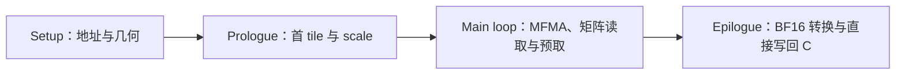
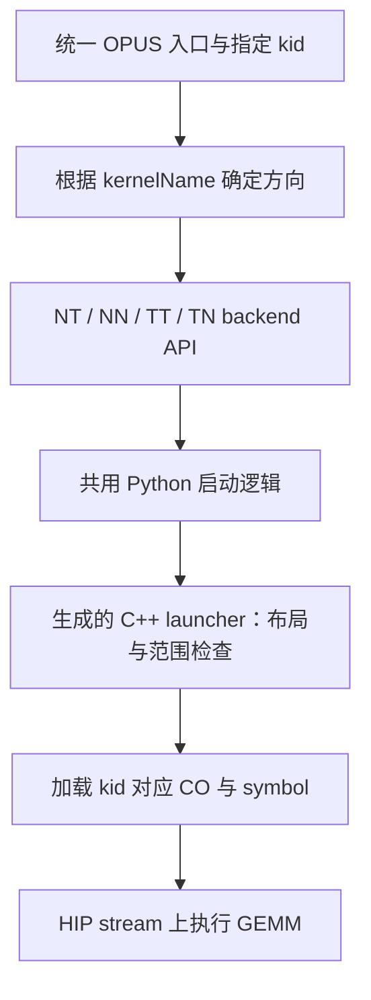

# OPUS MXFP8：基于 NT 扩展 NN / TT / TN 的流程、优化与进展

整理日期：2026-11-09。设备端最新版本以 2026-11-04 15:27 UTC 汇报的最终整理记录为准；最终报告生成于当日 15:25，最终性能文件生成于 15:16。

NN/TT/TN 已完成本地设备端优化、三份 CO 构建和公共接口调用验证。8192×8192×8192 的最新同轮测试中，三个方向分别比 NT 慢 8.87%、7.07%、9.09%，都进入了当时“比 NT 慢不到 10%”的目标范围。当前 PR 工作线尚未包含这条扩展，按方向自动 tune、CSV 保存和自动查表也还没有完成。

**1. 最新版本与代码对应关系**

当前留存这条扩展的工作区是：

```text
/root/workspace/aiter-opus-upstream-compare-20261016T171653Z
```

三份 pipeline 与 `/tmp/opus_mainloop_lambdas_20261104_d56ae76z/proposed_final/` 中的最终源码逐字节一致；三份 CO 的 SHA256 与同目录 `final_summary.json` 的记录全部一致。因此下面的最新测试结果能够对应到当前留存的源码和 CO。

| 方向 | Pipeline 文件 | 主循环位置 |
|---|---|---:|
| NN | [opus_gemm_pipeline_mxfp8_nn_4wave_gfx950.cuh](/root/workspace/aiter-opus-upstream-compare-20261016T171653Z/csrc/opus_gemm/include/gfx950/opus_gemm_pipeline_mxfp8_nn_4wave_gfx950.cuh:463) | 660 行 |
| TT | [opus_gemm_pipeline_mxfp8_tt_4wave_gfx950.cuh](/root/workspace/aiter-opus-upstream-compare-20261016T171653Z/csrc/opus_gemm/include/gfx950/opus_gemm_pipeline_mxfp8_tt_4wave_gfx950.cuh:451) | 671 行 |
| TN | [opus_gemm_pipeline_mxfp8_tn_4wave_gfx950.cuh](/root/workspace/aiter-opus-upstream-compare-20261016T171653Z/csrc/opus_gemm/include/gfx950/opus_gemm_pipeline_mxfp8_tn_4wave_gfx950.cuh:533) | 746 行 |

各方向另有对应 traits。三份 CO 位于 `csrc/opus_gemm/gen_co/gfx950/`，命名分别为：

```text
opus_gemm_gfx950_mxfp8_nn_4wave_co_256x256x256x128_2x2_16x16x128_1x128x128.co
opus_gemm_gfx950_mxfp8_tt_4wave_co_256x256x256x128_2x2_16x16x128_1x128x128.co
opus_gemm_gfx950_mxfp8_tn_4wave_co_256x256x256x128_2x2_16x16x128_1x128x128.co
```

**2. 从 NT 扩展的方式**

四个方向计算相同的逻辑 GEMM：`Y[M,N] = A[M,K] × B[K,N]`。扩展保留 NT 的 tile、wave、MFMA 和 scale 协议，再分别适配 A/B 的物理存储、global load、LDS 地址和片段读取。

| 方向 | A 的物理布局 | B 的物理布局 | A 的矩阵 LDS 读取 | B 的矩阵 LDS 读取 |
|---|---|---|---|---|
| NT | [M,K] | packed [N,K] | 原 NT 路径 | 原 NT 路径 |
| NN | [M,K] | packed [K,N] | 普通读取 | TR8 转置读取 |
| TT | [K,M] | packed [N,K] | TR8 转置读取 | 普通读取 |
| TN | [K,M] | packed [K,N] | TR8 转置读取 | TR8 转置读取 |

实现顺序是先隔离 NN 的 B 路径变化，再隔离 TT 的 A 路径变化，最后合并成 TN。这样可以分别判断两侧布局转换的成本，以及合并后 LDS、寄存器和指令队列的相互影响。

三个扩展方向共用以下硬件几何与协议：

- Block tile：256×256×128；256 threads，即 4 个 Wave64，wave layout 为 2×2。
- MFMA：16×16×128；输出为 BF16。
- 两份矩阵 LDS 槽用于交替准备和计算。
- K 为 runtime 值，循环次数为 `args.k / T::B_K`。
- E8M0 scale 按 K128 使用，scale panel 缓存 64 个 K128 列，到面板边界重新填充。
- CO 参数 ABI 为 96 字节，LDS 为 152064 字节。

固定 tile、LDS 和 64 列 scale panel 是这组 kernel 的配置；K 及循环次数仍在运行时确定。

**3. 最新 pipeline 的计算流程**



Prologue 准备 K tile 0、矩阵 LDS 数据和 scale。主循环集中处理当前 tile 的计算、下一 tile 的片段读取以及后续数据预取，并在 scale 面板边界完成 refill。尾部保留最后迭代所需的等待与边界处理，然后转换并写回 C。

最终 `main_loop_iteration` 内直接保留四个 lambda：

```text
mfma      当前片段的矩阵计算
load_a    A 片段读取
load_b    B 片段读取
prefetch  后续矩阵数据准备
```

整理中删除了外层 `coexecute_tile`、`accumulate_fragment` 包装和旧 MFMA 分支，`future_copy` 改为 `copy`。原共享 pipeline helper 的内容已经放回对应 pipeline，计算流程可以在各自文件内顺着阅读。

| 方向 | 整理前行数 | 整理后行数 | 减少 |
|---|---:|---:|---:|
| NN | 992 | 909 | 83 |
| TT | 977 | 900 | 77 |
| TN | 1062 | 982 | 80 |
| 合计 | 3031 | 2791 | **240** |

**4. 优化思路与最终保留的改动**

优化重点是 LDS 读取、AGPR 片段生命周期、scale 等待和 tile 边界的衔接。通过反汇编、ATT 时间线和同卡交错测试，判断减少等待是否真正转化为耗时改善，同时检查额外预取是否扩大寄存器活跃集合。

| 改动 | 最终状态与作用 |
|---|---|
| A/B 使用 AGPR | 所有 MFMA 的 A/B 操作数都已核对在 AGPR；三份 CO 均无 spill/scratch |
| C 寄存器分配 | C 不强制 pin，由 LLVM 分配到 VGPR/AGPR |
| 首 K tile 使用 C=0 | 去掉显式 C 清零，首轮 MFMA 直接使用零累加输入 |
| 16 字节直接写回 C | 去掉输出经过 LDS 的读写及对应同步 |
| TT/TN scale 预取 | 在当前 tile 的 MFMA 期间，将下一 tile 的 scale 从 LDS 提前读入 VGPR；保留面板换页处理 |
| 主循环整理 | 计算、加载和预取集中在 `main_loop_iteration` 内，减少外层包装 |

TT/TN 最终固定保留 scale 预取流程，`PrefetchScales` 参数和非预取分支已经删除；各方向只有一份单入口 CO。当天较早的“按 K 选择两份 CO”方案已被后续整理替换，不代表当前流程。

额外尾部片段缓冲、AGPR 搬运、padding 64/96、双 tile 展开和延后发布等方案也做过实验。它们没有稳定收益，部分增加寄存器压力、出现 spill 或导致短 K/窄 shape 回退，最终没有保留。

**5. 最新性能：11 月 4 日最终结构整理版**

最新测试来自 `after/bench_final.json`，通过公共调用路径启动当前 CO。四方向使用相同逻辑输入，在同一 GPU 上每轮随机交错测量，9 轮取中位数。每份 Graph 包含 16 次 GEMM，每个样本回放 8 次，共 128 次 GEMM。

输入构造、packing 和转置视图准备在计时前完成；以下数字是 GEMM 耗时，不含输入准备成本。

| 8192×8192×8192 | 整理前 µs | 最新 µs | 最新相对同轮 NT | 整理后耗时变化 |
|---|---:|---:|---:|---:|
| NT | 452.159 | 452.616 | 基准 | +0.101% |
| NN | 493.315 | **492.773** | **+8.872%** | −0.110% |
| TT | 484.197 | **484.599** | **+7.066%** | +0.083% |
| TN | 495.791 | **493.747** | **+9.087%** | −0.412% |

8192³ 三方向均进入当时“相对 NT 慢不到 10%”的目标范围，最后一次结构整理基本保持大 shape 性能。这个目标属于 NN/TT/TN 扩展，与另外一条 B-VGPR/m-repeat runtime-K 工作线的 1% 目标分开记录。

最新抽测还包括两个 shape：

| Shape | NT µs | NN µs／比 NT 慢 | TT µs／比 NT 慢 | TN µs／比 NT 慢 |
|---|---:|---:|---:|---:|
| 2048×7168×7168 | 92.841 | 101.392／9.210% | 99.662／7.347% | 102.592／10.503% |
| 256×256×128 | 6.532 | 7.521／15.143% | 7.577／16.009% | 7.808／19.540% |

`2048×7168×7168` 的 TT 相对整理前慢 1.192%，TN 相对 NT 超过 10%。短 K 的 256×256×128 也尚未进入 10% 范围，因此目前不能概括成所有 shape 均达标。

当天较早的优化对照用于说明 scale 预取的收益，不能与下午的最新结果混算：

| 11 月 4 日较早一轮，8192³ | 原版本 µs | 优化后 µs | 耗时下降 |
|---|---:|---:|---:|
| NN | 487.678 | 487.824 | −0.030%，基本持平 |
| TT | 498.105 | 480.561 | **3.522%** |
| TN | 503.296 | 490.157 | **2.611%** |

该轮 NT 为 450.666 µs，采用 GPU0、31 轮交错 Graph、每样本 160 次 GEMM。它记录的是前一阶段优化收益；当前源码性能以最新整理轮为准。

**6. 已完成的验证与实际边界**

最终结构整理通过 39 项常规检查，覆盖短 K、scale 面板边界和 Graph 回放；8192³ 四方向的完整输出与整理前逐位一致。三份 CO 的 ABI、LDS、资源 metadata 及最终 MFMA、DS、wait 数量保持，spill/scratch 均为零。

更严格的 FP64 近零抽检中，每方向 81920 个样本都有同一处超阈值点，NT、三个扩展方向以及整理前后共同存在。可以确认整理保持输出，仍不能声明所有严格 FP64 点或所有 shape 都已通过。

本报告的验证范围来自这条 layout 扩展的测试，不等同于 NT bpreshuffle 的 338/421 shape 调优覆盖。

**7. 公共调用的实现与进展**

11 月 4 日已通过原来的 `build_co.py` 构建三份 CO，并通过 common/JSON 注册、现有 codegen launcher 和公共 Python 接口完成调用验证。当时三份 CO 的编号为 NN 105、TT 106、TN 107；这是当时的注册编号。

最终提供四个 backend API：

```text
opus_gemm_a8w8_blockscale_bpreshuffle_nt
opus_gemm_a8w8_blockscale_bpreshuffle_nn
opus_gemm_a8w8_blockscale_bpreshuffle_tt
opus_gemm_a8w8_blockscale_bpreshuffle_tn
```

统一入口根据指定 kid 对应的 kernelName 转发到对应方向；方向 API 共用 `_launch_a8w8_blockscale_bpreshuffle_gemm`，校验 kid 方向，再调用相同 backend。codegen 共用 `gen_mxscale_bpreshuffle_instance()`，根据方向生成矩阵与 scale stride 检查，填入同一份 96 字节 ABI。



Python 层传入的矩阵都保持逻辑二维形状 `XQ[M,K]`、`WQ[N,K]`，用 stride 表示物理方向：

| 方向 | XQ stride | WQ stride |
|---|---|---|
| NT | (K,1) | (K,1) |
| NN | (K,1) | (1,N) |
| TT | (1,M) | (K,1) |
| TN | (1,M) | (1,N) |

NN/TN 的 B 按物理 [K,N] 完成 packing 后传入 transpose view。packing 是数据内容约定，仅凭 shape/stride 无法证明已正确完成；转置视图也需要保留对应 stride。

XQ/WQ 的数据类型为 `float8_e4m3fn`，Y 为连续 BF16；B 必须按对应物理方向经过 `shuffle_weight(..., layout=(16,16))`。scale 支持 `uint8` 和 E8M0。四个方向 API 的 `kid` 都是必须显式传入的关键字参数，默认编译集合不代表自动选择默认 kernel。

三个扩展方向的 SFA 为逻辑 `[M,K/128]`，stride 为 `(1,M)`；SFB 为逻辑 `[N/128,K/128]`，TT 使用 `(K/128,1)`，NN/TN 使用 `(1,N/128)`。K=128 时，只有一列 scale，生成的检查保留该单列情况。原 NT 路径保留其已有 scale 兼容范围。

当时三份扩展 CO 的接入范围是二维 GEMM、batch=1、BF16 输出，M/N 按 256 对齐、K 按 128 对齐，128≤K≤16384，并有 tensor 字节大小和 int32 地址范围限制。尚未为这三个方向增加 JIT 参数扫描或 tune 搜索。

两组 shape 的四方向直接入口和统一入口结果一致，四方向 Graph 回放通过；错误方向 kid 和无效输入的拒绝路径也检查过，原有 8 个接口测试通过。详见 [公共接口验证记录](/tmp/opus_four_backend_apis_20261104_p68ny3s2/final_summary.json)。

**8. 当前本地留存与 PR 接入状态**

| 部分 | 当前状态 |
|---|---|
| NN/TT/TN pipeline、traits、三份 CO | 旧工作区留存，源码和 CO 对应 11 月 4 日最终版 |
| 四方向 API、对应 codegen 与 common 方向支持 | 旧工作区仍保留 API、方向 stride 生成、common 的方向识别和 loader family map，并已做过公共调用验证 |
| 主 JSON 的三方向声明 | 后续 NT 工作线清理时已移出；当前主 JSON 为 56 条生产配置，常规注册表不会注册这三份 CO |
| 当前 PR 有效工作区 | `/root/workspace/aiter-opus-pr6696-ci-fix-64fe5b076`，本次核对为 `a9d0690`；不包含这条扩展的专用源码、CO 和方向接口接入 |
| 按方向自动 tune 与 CSV 选核 | 尚未完成；已有验证使用指定 kid |

因此“11 月 4 日本地接入并验证过”与“当前 PR 已发布接入”是两个不同进展。当前重新编号后的 kid 不能直接沿用这份历史编号解释。

继续推进时，剩余工作是恢复三方向在目标分支中的一致注册，补齐按方向生成候选和 CSV 查表流程，扩大正确性与性能测试范围，并评估短 K、窄 shape 及输入 packing 的端到端成本。当前已经保存的结论是：三个方向的设备实现、单入口 CO 和公共调用均有验证记录；8192³ 性能进入 10% 目标，其他 shape 仍有差距。

**9. 原始证据位置**

- [最新最终报告](/tmp/opus_mainloop_lambdas_20261104_d56ae76z/final_summary.json)：源码行数、CO 资源、验证结果、新旧计时和未 push 状态。
- [最新同轮原始计时](/tmp/opus_mainloop_lambdas_20261104_d56ae76z/after/bench_final.json) 与 [测试驱动](/tmp/opus_mainloop_lambdas_20261104_d56ae76z/bench.py)。
- [当天较早的优化对照](/tmp/opus_single_co_shared_entry_20261104_x_ofml_6/cleanup_backup/reports/opus_gap_compare_20261104T052306Z/final_8192_comparison.json)：TT/TN scale 预取收益。
- [CO 构建核对](/tmp/opus_layout_co_step1_20261104_r47srebp/co_validation.json) 与 [公共 launcher 接入核对](/tmp/opus_layout_co_step2_20261104_donabfpm/final_check.json)：接入阶段的记录，早于最终源码整理。
- [四方向公共 API 验证](/tmp/opus_four_backend_apis_20261104_p68ny3s2/final_summary.json)。
- [当前留存方向 API](/root/workspace/aiter-opus-upstream-compare-20261016T171653Z/aiter/ops/opus/gemm_op_a8w8.py:329) 与 [当前留存 codegen](/root/workspace/aiter-opus-upstream-compare-20261016T171653Z/csrc/opus_gemm/codegen/gen_instances_gfx950.py:3215)。

部分原始报告在历史整理时移入 `/tmp` 备份。本文件已记录主要数字、测试条件、代码对应关系和调用状态，阅读正文即可理解当前进展。
