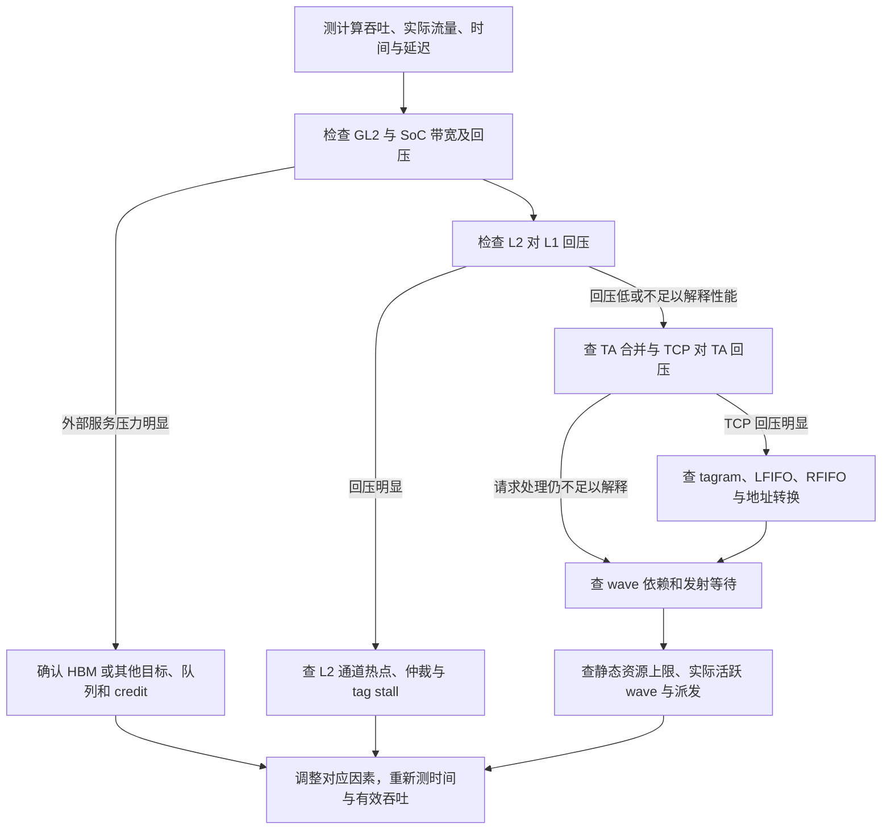

# 《AMD Instinct MI300 GPU Memory Bandwidth》第一至第五章总结

原文：[AMD Instinct MI300 GPU Memory Bandwidth](./mi300_gpu_bandwidth.pdf)。本文将第一、第二章的总体结构与理论带宽，第三章的实际带宽模型，第四章的测量诊断，以及第五章的全文结论放在一起。

第一至第五章融入了你提供的两份梳理，并按原文核对结构、公式、单位和结论。下文数值默认属于这份 2024 年文档；其中“MI350”列不能直接当作当前 CDNA 4 MI350X/MI355X 的已确认参数。

- [第一章：问题背景与内存系统主线](#chapter1)
- [第二章：总体结构与理论带宽](#chapter2)
- [第三章：简明概览与实际带宽模型](#chapter3)
- [第四章：性能测量与瓶颈定位](#chapter4)
- [第五章：全文总结](#chapter5)

<a id="chapter1"></a>

## 第一章重点：Introduction——为什么峰值带宽难以达到

原文第 1 章位于 PDF 第 1–2 页。它提出问题和全文分析思路；具体硬件结构在第 2.1 节、Figure 1 展开。为便于阅读，这里先整理贯穿全文的路径。

### 1.1 总体结构：派发、访存请求和数据返回

这三种过程相互配合。CPC/SPI 负责提供工作，CU 发出访问，缓存与内存系统服务访问。

**① 工作派发与指令执行。**

```text
Kernel 的工作组（WG）
→ CPC 领取并分配 chunk
→ SPI 展开工作组、分配资源和派发 wave
→ CU / SQ 调度 wave 的指令
→ VMEM 发出内存访问
```

**② 需要访问 HBM 的向量访存请求。**

```text
CU / SQ → VMEM → TA → TCP / vL1D → GL2 / L2
→ Infinity Fabric → LLC / AMD Infinity Cache → UMC → HBM
```

这条链描述沿途缓存未服务该请求、请求继续访问 HBM 的情况。访问可以在 L1、L2 或 LLC 命中后完成，也可能按指令策略绕过某些复用行为。UTCL1/UTCL2 的地址转换和页表访问还会影响请求推进。

**③ 数据返回与计算消费。**

```text
HBM → UMC → LLC → Infinity Fabric → L2 → TCP / vL1D
→ TD 重组返回数据 → CU 的 VGPR → 向量或矩阵计算
```

TA 主要处理请求地址，TD 主要重组返回数据；它们承担不同方向的工作。因此不宜把 `TA/TD → VMEM → VGPR → MFMA` 全部画成每次返回数据必经的串行硬件链。

MFMA 是 GEMM 等矩阵运算中的数据消费者。GEMM 还可能经 VGPR/LDS 暂存并复用数据，再提供矩阵指令操作数；一般内存请求可以用于其他计算或写回。**计算消费阶段与缓存层级应分别理解。**

### 1.2 关键模块各自负责什么

| 模块 | 作用 | 对带宽的影响 |
| --- | --- | --- |
| HBM | 外部高带宽存储 | 全卡容量与外部带宽上限 |
| UMC | 内存控制器 | 调度内存事务并连接 HBM 接口 |
| LLC / AMD Infinity Cache | 内存侧末级缓存 | 减少访问 HBM 的流量与等待 |
| Infinity Fabric | 连接计算 die、I/O die 和其他目标 | 请求路由、传输能力及拥塞 |
| L2 / GL2 | XCD 内多个客户端共享的缓存 | 通道仲裁、复用、汇总吞吐及外部出口 |
| L1 / TCP / vL1D | 每 CU 的向量 L1 与控制器 | tagram 查找、请求合并、缓存行和队列容量 |
| TA / TD | 请求地址处理 / 返回数据重组 | 地址吞吐与数据返回 |
| SQ / VMEM | 指令调度 / 向量访存管线 | 每 CU 请求供给和管线争用 |
| VGPR / LDS | 寄存器 / CU 局部共享存储 | 操作数暂存、数据复用与驻留资源约束 |

你提供的梳理用 `MALL` 指代内存侧末级缓存。本文统一使用原文的 `LLC / AMD Infinity Cache` 名称，在这条路径中表示同一个末级缓存位置。

### 1.3 瓶颈分析：峰值带宽和实际带宽之间有什么约束

```text
硬件理论峰值
        ↓ 受软件请求供给、各级处理速率、排队和回压约束
工作负载实际达到的带宽
```

即使 HBM 产品带宽约为 8 TB/s，程序仍需要足够的有效请求才能用满它。TA 地址处理、L1 热点/转换、L2 仲裁或下游服务能力，也可能更早形成限制。

原文特别关注每 CU 的带宽扩展能力：相同全卡 HBM 带宽，由多少个 CU 提供请求、每 CU 能持续提供多少请求，会影响最终结果。动态频率也改变内部通路的每秒带宽；后续模型主要按固定频率讨论。

**第一章的结论：实际带宽同时受硬件各级上限和软件隐藏延迟的能力约束。要沿完整路径找限制，才能解释为什么达不到峰值。**

---

<a id="chapter2"></a>

## 第二章重点：MI300 Theoretical Bandwidth——各层理论极限怎么算

原文第 2 章位于 PDF 第 2–6 页。2.1 说明结构，2.2 用总线宽度、实例数量和时钟计算理论带宽。

### 2.1 Performance Architecture：先确定实例之间的关系

Figure 1 的结构是：SoC 包含多个 AID；AID 承载 XCD 和 I/O 基础设施；每 XCD 有 4 个 Shader Engine，共享 4 MB、16 通道 L2；每 CU 有独立 32 KB vL1D、4 个 SIMD 和 LDS。原文每 SIMD 最多驻留 8 wave，每 wave 为 64 线程。

这决定了带宽需要按层级计算：**单 CU、单 L1、单 XCD、单 HBM stack、全卡汇总。** 例如 64 B/cycle/CU 与 2048 B/cycle/XCD 服务的实例范围不同。

### 2.2 通用换算：端口宽度 × 实例数 × 时钟

```text
带宽 = 每实例每 cycle 字节数 × 实例数 × 对应时钟频率

B/cycle × GHz = GB/s
GB/s / 1000 = TB/s
```

应注明读/写方向和对应时钟。CU/L2 侧按本文模型使用 SCLK，HBM 控制器侧使用 UCLK；LLC 通道时钟需要独立核对。

### 2.3 各级 Bytes/cycle 上限

| 层级/接口 | 原文每 cycle 上限 | 实例范围 | 含义 |
| --- | ---: | --- | --- |
| CU ↔ vL1D | 64 B/cycle | 单 CU | 共享 VMEM 与向量 L1 的数据通路上限 |
| LDS 局部通路 | 128 B/cycle；原文 MI350 列为 256 | 单 CU | 两组 SIMD pair 的 LDS 通路汇总 |
| vL1D ↔ L2 读 | 128 B/cycle | 单 vL1D 接口 | L1 与 L2 之间的读接口上限 |
| vL1D ↔ L2 写 | 64 B/cycle | 单 vL1D 接口 | 相应写接口上限 |
| L2 内部读 | 16 × 128 = 2048 B/cycle | 单 XCD | 16 通道读能力汇总 |
| L2 内部写 | 16 × 64 = 1024 B/cycle | 单 XCD | 16 通道写能力汇总 |
| L2 ↔ Fabric | 16 × 64 = 1024 B/cycle | 单 XCD | L2 经 EA 连接 SoC 的出口；原文说明读写共享 |
| LLC ↔ UMC 通道总宽度 | 128 × 64 = 8192 B/cycle | 全卡 | 需要乘对应 LLC 通道时钟才能得到每秒带宽 |
| UMC ↔ HBM PHY | 8 × 16 × 32 = 4096 B/cycle；原文 MI350 列为 8192 | 全卡、控制器时钟 | 8 stacks，每 stack 16 通道；MI350 列每通道为 64 B |

LDS 属于 CU 局部数据共享支路。它的读写峰值应按具体指令和设备核对，也不作为流式 HBM 路径必经的一层。

**不能把“CU 64、L2 2048、Fabric 1024、HBM 8192”直接比较大小：前三者有单 CU/单 XCD 范围差异，HBM 的时钟域又不同。** 比较前要统一成同一路径、同一范围的 GB/s 或 TB/s。

### 2.4 HBM 的理论带宽：从控制器侧接口算全卡

原文 MI300X / MI308 的模型：

```text
HBM_BW = 8 stacks × 16 UMC channels/stack × 32 B/cycle × 1.25 GHz
       = 5120 GB/s
       = 5.120 TB/s
```

原文 MI350 列采用 64 B/cycle、1.0 GHz：

```text
HBM_BW = 8 × 16 × 64 × 1.0
       = 8192 GB/s
       = 8.192 TB/s
```

你提供的约 8.2 TB/s 对应这个模型。**8192 GB/s 是每秒带宽；8192 B/cycle 是全卡控制器侧宽度，两者在 1.0 GHz 时才有相同的数值。** 当前 MI355X 官方标称 8.0 TB/s 应按其当前规格使用。

### 2.5 从单实例换算全卡，再比较路径上的限制

原文表 3 的主要全卡值为：

| 型号（原文列） | 总 CU | XCD 数 | SCLK | CU 通路汇总 | XCD → SoC 汇总 | HBM 模型带宽 |
| --- | ---: | ---: | ---: | ---: | ---: | ---: |
| MI300X | 304 | 8 | 1.30 GHz | 25.293 TB/s | 10.650 TB/s | 5.120 TB/s |
| MI308 | 80 | 4 | 1.42 GHz | 7.270 TB/s | 5.816 TB/s | 5.120 TB/s |
| MI350 | 256 | 8 | 1.00 GHz | 16.384 TB/s | 8.192 TB/s | 8.192 TB/s |

例如 MI300X：

```text
CU_BW  = 304 × 64 B/cycle × 1.3 GHz = 25.2928 TB/s
XCD_BW = 8 × 1024 B/cycle × 1.3 GHz = 10.6496 TB/s
```

原文最后给出：

```text
SoC_BW = min{CU_BW, XCD_BW, LLC_BW, HBM_BW}
```

这是对必须经过这些层级的流量取共同上限。各项使用一致的全卡单位；LLC_BW 需要其服务能力和时钟信息。L2 内部读 2048 B/cycle/XCD 与 XCD 出口 1024 B/cycle/XCD 是不同限制：命中 L2 的流量不需要继续经过这个出口。

**第二章的结论：用各级端口宽度和实例数量建立理论带宽上限，为 Roofline 和后续实测提供参考；达到这些上限还取决于第三章讨论的请求供给、效率与等待。**

---

<a id="chapter3"></a>

## 第三章重点：MI300 Attainable Bandwidth

原文：[AMD Instinct MI300 GPU Memory Bandwidth](./mi300_gpu_bandwidth.pdf)，第 3 章，PDF 第 6–19 页。

本章回答的是：**硬件有理论带宽上限，程序实际能够持续提供多少请求，哪些环节使请求排队、使 wave 等待？**

下文按原文解释公式和数值。文中的 FIFO 深度、仲裁效率、64 KB LDS 等参数属于这份 2024 年文档的模型；用于当前 MI355X 时，需要核对对应硬件参数。

### 第三章简明概览：每一节解决哪一个问题

```text
WG → CPC → SPI → Wave / CU / SQ → VMEM → TA → TCP / L1
→ GL2 / L2 → Fabric → LLC → UMC → HBM
```

前半段是工作供给与指令执行，后半段是访存请求继续向下游推进。实际带宽由请求供给、沿途处理速率、在途容量和返回延迟共同作用；不能把它直接理解成各级效率的固定乘积。

| 小节 | 核心问题 | 关键模型/数值 | 要得到的判断 |
| --- | --- | --- | --- |
| **3.1 前端派发** | 有没有及时提供足够 wave | 比较 `C_s / C_p`；比较 `T_s / T_p` | chunk 到来或 slot 补充是否跟得上 |
| **3.2 CU** | wave 能持续提供多少字节请求 | `BW_CU = min{W_o × n × R / (T_d + T_s), 64}` | 并发、请求量和周转时间能否支撑每 CU 通路 |
| **3.3 TA** | 地址处理是否跟得上 VMEM | 4 地址/cycle；合并 4、未合并 16 cycles/指令 | 地址处理对应的字节吞吐是否受限 |
| **3.4 TCP/L1** | 为什么 L1 请求推进受阻 | 4 tagram lookup/cycle、2 转换探测/cycle、704 条目 LFIFO | 地址热点、转换、队列和下游返回是否影响并发与等待 |
| **3.5 GL2/L2** | XCD 汇总请求能否被服务 | 内部读/写 2048/1024 B/cycle，乘仲裁效率；512 条目 LFIFO | L2 仲裁、通道分布或外部出口是否形成限制 |

#### 结合你提供的梳理，需要保留的计算条件

- `W_o` 在 3.2 表示每 CU 平均活跃 wave **数量**，代入公式时应使用数量；百分比 occupancy 需先换算。
- `R` 是整条 wave 内存指令的请求字节数。64 lane 各加载 8 B 时为 512 B；它不只是单 lane 的 load 字节数。
- `T_d` 是前一个 wave 结束到下一个 wave 开始之间的空闲间隙；`T_p` 是同一 slot 轮转获得下一 wave 的周期，两者定义不同。
- 表 5 的 `dword = 16 B/cycle` 对应 **未合并**。最佳 TA 合并下 `dword` 同样可到 64 B/cycle；`dwordx4` 未合并时也可对应 64 B/cycle。访问宽度应符合实际数据需求。
- Tagram 热点是不同缓存行被映射到同一集合，使查找串行或耗尽可用行。它与 LDS bank conflict 都涉及并行资源分布，但分别发生在缓存集合与 LDS bank，机制和计数器不同。
- 原文 MI350 列的 `2048 × 90% / 32 ≈ 57.6 B/cycle/CU` 是 L2 有效读带宽的均匀平均份额。它说明该模型的 L2 内部读能力可能早于 CU 64 B/cycle 通路成为限制，实际瓶颈仍需要请求路径、命中情况、客户端竞争与测量支持。

对 GEMM/Decode，值得重点关注 **wave 寿命和等待来源、TA 地址处理字节吞吐、L1 集合/转换/队列，以及 L2 有效吞吐与外部出口**。这些量需要联合分析，单个值不能直接确定当前 MI355X 的瓶颈。

### 3 开头：用 N = λT 解释为什么需要隐藏内存延迟

#### 核心关系

```text
N = λ × T
λ = N / T
```

| 量 | 含义 | 如果把分析对象定为内存请求 |
| --- | --- | --- |
| `N` | 系统平均在途数量 | 已发出、仍在系统中等待完成的平均请求数 |
| `λ` | 吞吐率 | 每 cycle 或每秒完成的请求数 |
| `T` | 平均停留时间 | 请求从进入到离开系统的平均时间 |

如果每个请求平均传输 `R` 字节，则可以进一步写成：

```text
带宽 BW = λ × R = N × R / T
目标在途请求数 N_required = BW_target × T / R
```

后两式是对 Little 定律的字节带宽换算。请求大小不同时，应采用一致的平均值和统计范围。

**本章的起点：要提高吞吐量，需要维持足够多的有效在途请求，并减少请求或 wave 的等待时间。** `N` 不等于单独的 wave occupancy：即使驻留很多 wave，如果它们都在等待依赖、没有继续发访存指令，内存管线仍可能供给不足。Little 定律中的 `N`、`λ`、`T` 必须统计同一类对象；计算内存请求吞吐时应使用请求停留时间，分析 wave 吞吐时才使用 wave 寿命。

#### 开头列出的六类限制

| 原文列项 | 限制什么 | 对 N 和 T 的影响 |
| --- | --- | --- |
| **Software design and optimization**：软件设计与优化 | 工作组大小、寄存器/LDS 使用量、访问宽度、地址排列、计算与访存重叠 | 决定能驻留多少 wave、每 wave 能提供多少有效请求，以及需要等待多久 |
| **Frontend workgroup and wavefront dispatch**：前端 WG/wave 派发 | CPC 是否及时提供工作组，SPI 是否及时把 wave 分给 CU | 供给不足导致 wave slot 空闲，降低有效并发，并增加派发间隙 |
| **Compute Unit instruction scheduling and issuing**：CU 指令调度与发射 | 各 wave 争用共享 VMEM，指令依赖和其他管线等待 | 限制请求发出速率，拉长 wave 寿命 |
| **Vector L1 cache**：向量 L1 | TA 地址处理、缓存策略、tagram 分布、地址转换、FIFO 和 L2 接口 | 限制每 cycle 的处理量、可容纳的在途请求，并向 CU 回压 |
| **Vector L2 cache**：向量 L2 | 通道仲裁、缓存策略、队列、SoC 出口 | 限制所有客户端的汇总吞吐，并把下游等待传回 L1 |
| **SoC bandwidth-latency dynamics**：SoC 带宽与延迟变化 | fabric、LLC、内存控制器、HBM 的服务能力 | 决定请求完成速度和往返延迟；拥塞会向 L2 回压 |

原文把 SoC 侧视作黑箱，主要分析计算侧到 L2 的行为，并假定频率固定。随着优化推进，瓶颈可能从一个环节转移到另一个环节。

### 3.1 Frontend Workgroup and Wave Dispatch：前端能否持续供给工作

这一节分两次比较：**chunk 的供给与消耗；wave 的执行寿命与 slot 的补充周期。**

#### 3.1.1 Workgroup Dispatch：CPC 再拿到 chunk 前，SPI 会不会已经派发完

先明确符号：

| 符号 | 含义 |
| --- | --- |
| `C` | 一个 chunk 里有多少个工作组 |
| `WG` | 每个工作组有多少个 wave；这里单位是 wave/WG |
| `#XCD` | 系统的 XCD 数量 |
| `#SPI` | 每个 XCD 的 SPI 数量，本文为 4 |
| `C_p` | 某个 CPC 轮转到下一个属于自己的 chunk 的周期 |
| `C_s` | 一个 SPI 派发完当前 chunk 分给自己的全部 wave 所需时间 |

**① CPC 再获得 chunk 的周期。** CPC 按轮转方式领取 chunk，遍历速度为 1 工作组/cycle：

```text
C_p = #XCD × C                         [cycles]
```

例如 8 个 XCD，每个 CPC 领取间隔为 8 个 chunk。

**② SPI 消耗自己那份工作所需时间。** 每个 SPI 分到 `C / #SPI` 个工作组，每组 `WG` 个 wave，SPI 派发速度为 4 cycles/wave：

```text
C_s = (C / #SPI) × WG × 4              [cycles]
```

这里的“消耗”指把 wave 派发到 CU，不是这些 wave 已经执行完。

**③ 比较两者，判断工作组派发限制。**

```text
C_s < C_p
→ SPI 已派发完当前工作，但下一份 chunk 还没到
→ 前端工作供给不足

(C / #SPI) × WG × 4 < #XCD × C
WG < #XCD × #SPI / 4

本文 #SPI = 4，因此：WG < #XCD
```

对 8-XCD 的 MI300X，本文得到 `WG < 8 wave/工作组` 的界限；对 4-XCD 配置，相同推导得到 `WG < 4`。

例如 `#XCD = 8、C = 8、WG = 4`：

```text
C_p = 8 × 8 = 64 cycles
C_s = (8 / 4) × 4 × 4 = 32 cycles
```

SPI 32 cycles 就能派发完自己分到的 wave，而 chunk 供给周期为 64 cycles。按照这个简化模型，前端消耗工作快于工作到来。两者之比为：

```text
C_s / C_p = WG / #XCD                  [本文 #SPI = 4]
```

这个比值是从原文两式得到的辅助判断量。小于 1 表示供给存在间隙；它不能直接当作实际 kernel 的利用率，因为资源不足、回压、派发重叠等还会影响运行。

**这一小节给的信息：工作组太小时，多 XCD 轮转派发可能使 SPI 缺少工作。判断要同时使用工作组的 wave 数和 XCD 数。**

#### 3.1.2 Wave Dispatch：wave 结束后，slot 能否及时补上

SPI 派发工作组前，必须确认该工作组所有 wave 的 VGPR、SGPR、LDS、barrier、wave slot 等资源都可满足。因此先有一个**静态资源允许的驻留上限**。

例如本文的 CU 有 64 KB LDS，工作组使用 32 KB LDS、包含 4 个 wave：

```text
最多驻留工作组数 = 64 KB / 32 KB = 2
由 LDS 决定的驻留上限 = 2 × 4 = 8 waves/CU
```

其他资源还可能进一步收紧这个上限。这里的 64 KB 是原文例子的硬件值。

接着，原文从 wave slot 的角度计算轮转补充周期。设：

- `W_o`：本小节按静态资源约束采用的每 CU 目标驻留 wave 数。
- `T_p`：工作分配轮转一圈，使同一 wave slot 获得下一 wave 的派发周期。
- `T_s`：一个 wave 从建立到退出的执行寿命。

原文公式 (2)–(3)：

```text
T_p = C × #XCD × #SE/XCD × #CU/SE × W_o / (WG × C)
    = #TotalCUs × W_o / WG                          [cycles]
```

`C` 在推导中消掉了；这个周期取决于总 CU 数、目标驻留 wave 数以及每工作组 wave 数，并沿用原文的轮转派发假设。

判断条件是：

```text
T_s < T_p → wave 结束速度快于 slot 补充速度 → wave dispatch bound
```

你说的“wave 寿命与 slot 重新装填所需时间的比值”可以整理成：

```text
ρ_wave = T_s / T_p
```

**这是方便阅读而定义的比值，原文直接给的是 `T_s < T_p` 条件。** `T_p` 表示同一 slot 获得 wave 的轮转周期，并不是 slot 空下来之后才开始计时的纯空闲时间。

| 比值 | 按原文模型怎么判断 |
| --- | --- |
| `ρ_wave < 1` | wave 提前完成，slot 存在等待补充的间隙，可能受 wave 派发限制 |
| `ρ_wave = 1` | wave 寿命与补充周期相当 |
| `ρ_wave > 1` | 寿命足以覆盖这个补充周期；仍需检查执行、资源和访存限制 |

原文例子：MI300X 有 304 CU，`WG = 4、W_o = 32`：

```text
T_p = 304 × 32 / 4 = 2432 cycles
T_s < 2432 cycles 时，本文模型判断为 wave 派发受限
```

如果 `T_s = 1200 cycles`，则 `ρ_wave ≈ 0.493`，说明 wave 在该轮转补充周期的一半左右就已结束。**这个比值不是全 GPU 的实测 occupancy，也不意味着应主动拖长 wave。优化目标是提高有效供给和吞吐量。**

**3.1 合起来给出的信息：** `C_s / C_p` 检查 chunk 层面的工作供给，`T_s / T_p` 检查 wave slot 层面的持续供给；静态资源允许驻留多少 wave，还需要结合这些派发时间判断实际能否持续达到该并发。

### 3.2 Compute Unit：把 wave 的工作量和时间换算成每 CU 带宽

#### 硬件背景

一个 CU 的 4 个 SIMD 共用一条 VMEM 管线。CU 向向量 L1 传命令、地址和写数据，三者分别有 FIFO，深度为 48、48、64。

一个 wave 有 64 个线程；VMEM 分 4 个阶段，每阶段处理 16 个线程。因此无下游回压时，一条指令信息约 4 cycles 传完。TA/L1 接收不及，会回压 VMEM，增加指令间距，拉长 wave 寿命。

#### 原文公式 (4)–(5)

```text
BW_CU = W_o × n × R / (T_d + T_s)                  [B/cycle]

BW_CU = min{W_o × n × R / (T_d + T_s), 64}         [B/cycle]
```

| 量 | 原文定义 | 公式中提供的信息 |
| --- | --- | --- |
| `W_o` | 稳态每 CU 平均活跃 wave 数 | 多少 wave 在共同提供请求 |
| `n` | 每 wave 的内存指令数 | 每个 wave 提供多少次访问 |
| `R` | 每条内存指令的请求字节数 | 每次访问传多少字节 |
| `T_d` | 前一个 wave 结束到下一个 wave 开始之间的间隙 | 前端补充工作造成的等待 |
| `T_s` | wave 建立到退出的执行寿命 | 包括计算、依赖、访存、barrier 和管线等待 |
| `64` | CU ↔ 向量 L1 的 64 B/cycle 通路上限 | 请求供给再充足，也受该通路限制 |

64 个线程各读 8 B 的 `buffer_load_dwordx2`：

```text
R = 64 threads × 8 B/thread = 512 B/instruction
n × R = 一个 wave 请求的总字节数
```

当访问宽度不一致时，`n × R` 应理解为逐条请求字节数的总和，或使用相应的平均请求大小。

**公式的含义：用参与供给的 wave 数乘每 wave 请求量，再除以包含派发间隙的周转时间，估算每 CU 每 cycle 能提供的字节数，最后取 64 B/cycle 上限。**

达到这个上限需要在模型中满足：

```text
W_o × n × R ≥ 64 × (T_d + T_s)
```

#### 由公式得到的优化方向

- **提高有效并发 `W_o`：** 减少不必要的 VGPR、LDS 等资源占用，使更多 wave 能提供请求。
- **提高每 wave 的有效请求量 `n × R`：** 选择合适的访问宽度和工作量；额外无用访问也会增加计数字节，不能视作有用带宽提升。
- **减少 `T_d`：** 改善 3.1 所讨论的工作组/wave 供给。
- **减少 `T_s` 中的等待：** 重叠计算与访存，减少依赖、barrier、缓存和下游排队。

这些量会互相影响。例如增加驻留 wave 会提高并发，也可能使共享 VMEM 更拥挤，导致 `T_s` 增长；增加请求量也可能填满下游 FIFO。因此不能假定只改分子、分母保持不变。

**符号使用要留意：** 3.1 的 `W_o` 用于静态资源允许的目标驻留量，3.2 则把它描述为实际稳态平均活跃 wave 数。原文同时用 `T_d + T_s` 表示 slot 周转时间，属于简化估算；若已有按完整时间窗测得的平均活跃 wave 数，再额外扣除同一派发间隙，可能重复计算空闲影响。实际代入时应统一 occupancy 和时间的统计口径。

**这一节给的信息：每 CU 带宽由有效并发、每 wave 请求量、前端间隙和执行寿命共同决定；3.3–3.5 接下来解释请求速率和等待时间受哪些硬件环节约束。** 这里的字节数是 CU 侧请求量；访问命中缓存时，它与物理 HBM 流量会不同。

### 3.3 Texture Addressing Unit（TA）：每条指令的地址要处理多久，折合多少 B/cycle

TA 位于 CU 和 TCP 之间，把 VMEM 指令转换为 TCP 可以查找的地址信息；返回方向由 TD 重组数据并交给 CU。

#### 计算①：地址传递时间

- CU 理想输入：4 cycles/指令。
- TA 输出：每 cycle 向 TCP 传 4 个地址。
- 未合并：64 个线程地址需要 `64 / 4 = 16 cycles`。
- 可合并的最佳情况：每个地址编码最多 4 个连续线程访问，64 个线程变成 16 个地址，需要 `16 / 4 = 4 cycles`。

TA 的这种地址合并最多支持每线程 1 DWORD（4 B）。本文中的 `dwordx2/x4` 无法使用这种 TA 合并。

#### 计算②：每条指令的字节吞吐

根据原文表 5，可以用下面的辅助计算理解：

```text
TA 环节的字节吞吐上限 = 每条 wave 指令请求字节数 / TA 处理该指令地址所需 cycles
```

| 指令 | TA 合并 | 每线程字节数 | 每 wave 指令字节数 | TA 处理时间 | 该环节每 CU 上限 |
| --- | --- | ---: | ---: | ---: | ---: |
| `buffer_load_dword` | 否 | 4 B | 256 B | 16 cycles | 16 B/cycle |
| `buffer_load_dword` | 是，最佳情况 | 4 B | 256 B | 4 cycles | 64 B/cycle |
| `buffer_load_dwordx2` | 否 | 8 B | 512 B | 16 cycles | 32 B/cycle |
| `buffer_load_dwordx4` | 否 | 16 B | 1024 B | 16 cycles | 64 B/cycle |

#### 得到的限制与结论

未合并指令以 4 cycles/条进入 TA，却需要 16 cycles/条才能向 TCP 传完地址。连续突发会积压；原文展示约 12 条指令的突发就能导致 FIFO 溢出压力和 CU 回压，发射间隔随后拉长到约 16 cycles/条。

**3.3 算的是地址处理速率对应的每 CU 字节吞吐。** `dwordx2` 每 wave 请求 512 B，但 TA 要用 16 cycles，所以这一环节只能提供 32 B/cycle。`dwordx4` 虽然也无法 TA 合并，但每指令传 1024 B，能够对应 64 B/cycle，并减少完成同样字节量所需的指令及部分 tagram 查找压力。

原文因此建议在访问需求允许时使用 `dwordx4`。表中的“达到每 CU 上限的 50%”描述的是这一环节，不能直接换成“整机 HBM 利用率 50%”；整机还取决于活跃 CU 数、缓存命中及后续路径。

### 3.4 TCP：L1 的处理速率、可用并发容量和排队限制

TCP 就是向量 L1 缓存及控制器。**这一节没有给一个新的总带宽公式，而是逐部件说明：请求能否并行处理、最多缓存多少等待中的请求、哪里会回压。**

基本组织：4 个 tagram，每个 64 条缓存行，每条 128 B：

```text
L1 总容量 = 4 × 64 × 128 B = 32 KB
```

#### 3.4.1 缓存策略：访问能否复用 L1 中的数据

| 访问 | Temporal | Non-temporal |
| --- | --- | --- |
| Read，wave/group scope | 允许命中，LRU 更新 | Forced-miss，Evict 更新 |
| Read，device/system scope | Forced-miss，Evict 更新 | Forced-miss，Evict 更新 |
| Write | Forced-miss，LRU 更新 | Forced-miss，Evict 更新 |
| Atomic | Forced-miss，Evict 更新 | Forced-miss，Evict 更新 |

Forced-miss 会按未命中处理，消除原有行的复用；Evict 使缓存行在服务完成后尽快可回收。没有预期复用的流式访问，可能受益于这种快速周转。

**给的信息：temporal 提示与访问 scope 一起决定 L1 命中和复用，进而决定多少流量进入 L2，以及缓存行占用多久。**

#### 3.4.2 Input：输入 FIFO 能否继续接收请求

命令/地址/数据 FIFO 深度为 **10/6/4**。地址 FIFO 满时回压 TA。

**限制：短时间的请求突发可以缓冲，持续超出后续处理能力时会把停顿传回 CU。**

#### 3.4.3 Tagram Mapping：地址能否分散到 4 个并行集合

同一 cycle 进来的线程地址会先合并成唯一缓存行；不同 cycle 的地址不做这种合并。随后把缓存行映射到 4 个 tagram，每个每 cycle 最多查一次。

```text
均匀分布时：最多 4 次 tagram lookup/cycle
全落同一 tagram：最多 1 次 lookup/cycle
单 tagram 可用容量：64 × 128 B = 8 KB
```

默认连续缓存行映射为 `0 → 2 → 1 → 3` 循环。周期性相隔 **512 B** 的地址会落到同一个 tagram，既使查找串行，又可能在其他集合仍空闲时就耗尽该集合的 64 条缓存行。

Buffer 指令的 cache swizzle 可以按 descriptor 中的 stride 改变映射，本文支持的相应 stride 为 256 B–8 KB 的 2 的幂；flat 指令不使用该机制。swizzle 改变热点的出现方式，例如 512 B swizzle 下，相隔 2 KB 的周期访问仍会落到同一集合。

**给的信息：32 KB 总容量和 4 lookup/cycle 总峰值能否被使用，取决于地址在四个集合间的分布。** TA 的线程地址合并与这里的同 cycle 缓存行合并是两个步骤。

#### 3.4.4 地址转换：UTCL1 接口每 cycle 能接受多少转换

4 个 tagram 最多同时提出 4 个转换请求，TCP ↔ UTCL1 接口最多 **2 次探测/cycle**，3–4 个同时请求需要串行。

此外两个接口按 lock-step 工作，都能接收时才能继续发送；FIFO 满或一侧未准备好会阻塞 TCP。

**限制：即使没有严重 TLB miss，转换接口速率和排队也可能限制吞吐；miss 则进一步增加往返等待。**

#### 3.4.5 Tagram Lookup：L1 查找和 L2 miss 发送速度不同

```text
L1 tagram 查找：最多 4 lookup/cycle
控制器接收 miss：最多 4 miss/cycle
向 L2 发送请求：最多 1 request/cycle
```

大量 miss 时，前面产生请求可能快于后面发出请求，需要缓冲与合并。返回数据准备好后，LFIFO 对应条目出队，缓存读取还需处理 RAM bank 冲突。

**给的信息：L1 本地查找峰值、L1→L2 请求发送峰值和数据返回能力分别约束不同阶段。**

#### 3.4.6 Cache Controller：哪些资源耗尽会阻止前进

原文列出四类停顿来源：LFIFO 满、RFIFO 满、缓存 RAM 写入被返回数据路径阻塞，以及输入写数据 FIFO 为空。

**限制：控制器不能推进时，会继续回压 tagram、TA 和 CU；因此观察到 TA 停顿，也需要往 TCP 内部和下游找原因。**

#### 3.4.7 Latency FIFO：能容纳多少等待数据返回的请求

LFIFO 深度为 **704 条目**，缓存 hit 和 miss 请求都会进入其中等待数据可用。表 8 按访问类型计算它能表示的缓存行数量：

| 访问类型 | 每 LFIFO 条目表示的数据量 | 每指令消耗条目 | 表 8 的缓存行数量 |
| --- | --- | ---: | ---: |
| `dword` Read | 4 DW = 16 B | 16 | 88 |
| `dwordx2` Read | 8 DW = 32 B | 16 | 176 |
| `dwordx4` Read | 16 DW = 64 B | 16 | 352 |
| `dword` Write | 2 CL | 1 | 1408 |
| `dwordx2` Write | 4 CL | 1 | 2816 |
| `dwordx4` Write | 8 CL | 1 | 5632 |

例如读操作按原文表格换算：

```text
dword Read：  704 × 16 B / 128 B = 88 CL
dwordx2 Read：704 × 32 B / 128 B = 176 CL
dwordx4 Read：704 × 64 B / 128 B = 352 CL
```

这是 **LFIFO 条目的请求数据表示能力**，不能直接当作 32 KB L1 的驻留容量，也不能当作最终独立 HBM 在途缓存行数；地址重叠、tagram 容量、合并和其他队列会继续施加约束。写入还采用不同的条目累积与合并方式。

**给的信息：相同 FIFO 深度下，访问宽度会改变能够表示的等待数据量。队列装满前可容纳多少并发请求，决定了能隐藏多长的延迟。** 这对应开头 `N = λT` 中的在途容量限制。

#### 3.4.8 L2 Interface：L1 向 L2 的出口有多快

RFIFO 深度为 **64**，最多每 cycle 接收 4 个 TCP miss，请求发往 L2 的速率为 1 request/cycle。读请求大小为 128 B，写请求大小为 64 B。

```text
该请求接口的字节速率：
读：1 request/cycle × 128 B = 128 B/cycle
写：1 request/cycle ×  64 B =  64 B/cycle
```

L2 无法继续接收时会向 TCP 回压；可用 `TCP_TCR_TCP_STALL_CYCLES` 观察。

**3.4 合起来给的信息：缓存策略决定流向 L2 的请求量；tagram 和地址转换决定并行处理速度；LFIFO/RFIFO 决定能缓冲多少等待；L2 接口和回压决定请求能否继续前进。这些共同影响 3.2 的有效并发和 wave 寿命。**

### 3.5 Vector-L2 Cache：XCD 汇总吞吐、仲裁损失和 SoC 出口限制

L2 汇总 XCD 内 CU、指令缓存、标量 L1、UTCL2 等客户端的请求。它有 **16 个独立通道、合计 4 MB**，每通道为 128 sets × 16 ways，缓存行为 128 B。

#### 3.5.1 Cache Policy：多少请求可以在 L2 命中

- **LRU：** 可命中，访问更新缓存行年龄，支持继续复用。
- **Streaming：** 可命中，但不刷新年龄，使缓存行更快可替换，适合较少复用的数据。
- **Bypass：** 强制外部获取、临时存放，服务后失效，不保留用于后续复用。

具体选择还取决于访问 scope 和分区模式：

| Read/Write 的 scope 与配置 | Temporal | Non-temporal |
| --- | --- | --- |
| Wave/Group | LRU | Streaming |
| Device，CPX | LRU | Streaming |
| Device，SPX/DPX | Bypass | Bypass |
| System | Bypass | Bypass |
| Atomic | Bypass | Bypass |

**给的信息：L2 策略决定请求是否在 XCD 内完成，还是继续经过 fabric/LLC/HBM。** 因此 non-temporal 在 L2 可以仍然命中，具体行为由 scope 和分区配置共同决定。

#### 3.5.2 Arbitration Network：理论带宽乘仲裁效率，再折算每 CU

客户端通过读 128 B、写 64 B 的总线连接通道，每通道每 cycle 服务 1 个请求：

```text
L2 峰值读带宽 = 16 × 128 = 2048 B/cycle/XCD
L2 峰值写带宽 = 16 ×  64 = 1024 B/cycle/XCD

L2 有效带宽 = 峰值带宽 × 仲裁效率
每 CU 平均份额 = L2 有效带宽 / 每 XCD 活跃 CU 数
```

原文表 10 对 MI300X 给出读仲裁效率约 90%、写约 58%、38 CU/XCD：

```text
读：2048 × 90% ≈ 1843 B/cycle/XCD
    1843 / 38 ≈ 48.5 B/cycle/CU

写：1024 × 58% ≈ 594 B/cycle/XCD
    594 / 38 ≈ 15.6 B/cycle/CU
```

**算出的信息：经过仲裁后，实际有效吞吐低于总线宽度给出的峰值。** 每 CU 数值是按客户端流量较均匀的方式分摊所得；通道热点、其他 L2 客户端竞争还会改变实际份额。

原文 MI350 列的读仲裁效率同样为 90%，32 CU/XCD：

```text
L2 有效读带宽 = 2048 × 90% = 1843.2 B/cycle/XCD
每 CU 平均份额 = 1843.2 / 32 = 57.6 B/cycle/CU
```

该份额低于每 CU 的 64 B/cycle 通路，说明在本模型中，当多个 CU 均匀、持续地请求 L2 数据时，L2 内部读带宽可能先限制汇总吞吐。**这是原文效率模型算出的份额；实际是否受限还要结合 L1/L2 命中、通道分布、其他客户端和后续服务能力判断。** 需要访问 HBM 的请求还受 XCD 出口与更下游约束。

表 10 中 MI350 的写仲裁效率为 75%，本文模型给出 `768 / 32 = 24 B/cycle/CU`。该列属于原文所列型号参数，不能直接代入当前 CDNA 4 MI355X。

#### 3.5.3 Input Buffer：请求和写数据能否及时配合

写/原子请求与数据异步到达，通道仲裁决定哪个客户端发送数据。一个客户端同 cycle 只能赢得向一个通道写数据的机会；16 个通道可并行服务请求。

**限制：16 通道的汇总峰值依赖请求分布，以及写数据能否及时到达。**

#### 3.5.4 LFIFO：L2 能缓存多少等待中的事务

L2 有共享的 **512 深 LFIFO**，每客户端另有 **7 深 FIFO**，用于容纳等待并保持客户端间并发。

**给的信息：L2 也需要足够的在途容量才能隐藏 SoC 往返延迟。** 原文没有在这里给出统一的“512 条目等于多少字节带宽”公式；换算需要事务大小、条目占用方式和往返延迟。

#### 3.5.5 Fabric Interface：XCD 出口有多宽，下游如何回压

每 L2 通道通过读写共享的 64 B 总线连接 SoC：

```text
L2 ↔ SoC 汇总出口 = 16 × 64 = 1024 B/cycle/XCD
```

因此本章模型的 L2 内部峰值读能力为 2048 B/cycle/XCD，而继续流向 SoC 的出口为 1024 B/cycle/XCD。L2 命中读与 L2 miss 后访问外部内存，受约束的路径不同。

SoC 侧相应缓冲资源耗尽时，L2 被回压，并可能继续传到 L1 和 CU。

**3.5 给出的信息：L2 内部仲裁决定有效汇总吞吐，SoC 出口决定继续向外的通路上限，下游延迟和回压决定队列多久释放。** 明显 SoC stall 是外部路径受限的线索，仍应结合流量目标、带宽和延迟判断。

### 按节对照：第三章各部分到底得到什么

| 部分 | 计算或分析的对象 | 得到的关键结果 |
| --- | --- | --- |
| **3 开头** | 在途数量、吞吐、停留时间 | `N = λT`；高带宽需要足够多有效在途请求来覆盖延迟 |
| **3.1.1** | chunk 到来周期与 SPI 派发时间 | `C_p = #XCD × C`；`C_s = C/#SPI × WG × 4`；本文得到 `WG < #XCD` 的供给限制 |
| **3.1.2** | wave 寿命与 slot 轮转补充周期 | `T_p = #TotalCUs × W_o / WG`；`T_s < T_p` 时可能受 wave 派发限制 |
| **3.2** | 每 CU 的 wave 请求量与周转时间 | `BW_CU = min{W_o × n × R / (T_d + T_s), 64}` |
| **3.3** | TA 处理一条指令地址的时间 | 合并为 4 cycles、未合并为 16 cycles；不同指令对应 16/32/64 B/cycle 的每 CU 上限 |
| **3.4** | L1 各部件的速率、缓存复用、队列和热点 | 4 tagram lookup/cycle、2 UTCL1 probe/cycle、1 L2 request/cycle；FIFO 和地址分布限制有效在途容量 |
| **3.5** | L2 汇总吞吐、仲裁效率及外部出口 | 内部读/写峰值 2048/1024 B/cycle/XCD，乘仲裁效率得到有效值；SoC 出口为 1024 B/cycle/XCD |

读第三章时，始终可以沿着一条链检查：**前端有没有及时提供 wave → wave 能不能持续发有效请求 → TA/L1/L2 能不能接收和处理 → 下游能不能及时返回并释放资源。** 一个下游队列满，会逐级回压，最终表现为 CU 发射变慢、wave 寿命增长、实际带宽下降。

---

<a id="chapter4"></a>

## 第四章重点：MI300 Bandwidth Attainment Analysis

原文：[AMD Instinct MI300 GPU Memory Bandwidth](./mi300_gpu_bandwidth.pdf)，第 4 章，PDF 第 19–25 页。关键计数器及指标定义见附录表 12、13（第 27–28 页）。

第三章说明各环节怎样限制请求速率和延迟；**第四章说明怎样用测量确定这些限制在实际 kernel 中是否发生，以及瓶颈在哪里。**

下文沿用第三章文档的思路：每一节写清“测什么 → 怎么算或比较 → 得到什么信息 → 下一步查什么”。原文硬件参数、指标名称和示例阈值属于这份 2024 年文档；分析当前 MI355X 时，需使用对应设备和 profiler 的定义。

### 第四章简明概览：从模型走到实际瓶颈

你提供的“前三章讲硬件，第四章讲 Debug”概括了这一章的用途：**把已有性能模型对应到 rocprof/perfmon 的观测，沿着回压和等待找到限制原因。** 前三章也包括软件请求行为；第四章主要使用这些模型解释实测结果。

| 小节 | 先问的问题 | 关键观测 | 这一节要完成什么 |
| --- | --- | --- | --- |
| **4.1** | counter 记录的是次数、时间还是在途量 | Clocking、Workload、IP Architecture、IP Microarchitecture | 正确解释计数器与派生指标 |
| **4.2.1** | kernel 当前完成了多少工作、搬了多少数据 | FLOP/s、GL2 ↔ SoC 字节数/时间、延迟 | 建立性能基线和瓶颈候选 |
| **4.2.2** | L2 或 SoC 是否阻止 L1 继续发请求 | L2 → L1 回压、tag stall、hit/util、通道分布 | 区分内部仲裁/热点与外部服务限制 |
| **4.2.3** | TA、TCP、转换和队列哪里推进不及 | TA 合并率、TCP → TA 回压、set/FIFO/UTCL1 stall | 定位 L1 路径的具体限制 |
| **4.2.4** | wave 的寿命主要由什么组成 | Dependency Wait、Issue Wait、Execute | 解释第三章 `T_s` 的来源 |
| **4.2.5** | 为什么可运行 wave 少、补充不及时 | VGPR/AccumVGPR/SGPR/LDS 用量、SPI stall、动态活跃 wave | 区分资源上限和实际并发，对应 `W_o` 与派发 |

**本章的关键问题：哪个接口开始挡住上游，是什么使它不能继续服务请求，这种等待是否影响了 kernel 完成时间？** 微架构计数器帮助找到原因，带宽、延迟和时间数据则帮助确认影响。

### 4 开头：把第三章的模型变成可验证的诊断

本章的主线是：

```text
测 kernel 实际计算量、接口流量和时间
→ 检查 L2 ↔ SoC 的带宽、延迟与回压
→ 检查 L1 ↔ L2 的流量与回压
→ 检查 TA / TCP / 地址转换的处理与等待
→ 检查 CU 的 wave 时间分布
→ 检查 SPI 派发与静态资源约束
```

这是原文章节展开的顺序。Figure 9 提供的是带宽诊断路径，不是所有 kernel 都必须机械执行的判定规则。性能可能同时受多个因素影响，优化后主瓶颈也可能转移。

**和第三章 `N = λT` 的对应关系：**

- 流量与时间测量得到实际吞吐 `λ` 或字节带宽。
- FIFO 满、资源不足、地址分布和派发效率，解释为什么有效在途数量 `N` 不够。
- 内存延迟、依赖等待和回压，解释为什么停留时间 `T` 过长。

目标是把“带宽低”拆成能够定位、能够修改的具体原因。

### 4.1 Perfmons and Performance Metrics：四类计数器分别提供什么信息

**Perfmon event 是硬件计数器记录的原始量；metric 是由原始量计算出的指标。** 原始量可以是次数、cycles、quad-cycles、累计在途数量等，不能全部当成百分比。

#### 第一类：Clocking，时间和忙碌程度

| 量 | 原文例子 | 能回答的问题 |
| --- | --- | --- |
| 总经过周期 | `GRBM_GUI_COUNT`，对应 `GPU_WALL_CLK` | 测量窗口共持续多久 |
| GPU 忙碌周期 | `GRBM_GUI_ACTIVE`，对应 `GPU_BUSY` | 有至少一个 wave 活跃的时间有多少 |
| 模块忙碌周期 | `TCP_BUSY`、`TCC_BUSY` 等 | 某模块处理请求的时间有多少 |

一般可以计算：

```text
利用率 = 忙碌 cycles / 总经过 cycles
```

**给的信息：模块是否活跃，以及其他指标应使用哪个时间分母。** “GPU 有 wave 活跃”并不意味着计算或内存管线已满载；wave 可能正在等待。

#### 第二类：Workload Characterization，程序发出了什么工作

测量指令混合、读/写/原子比例、访问类型和不同大小的请求数量。例如 VMEM 指令计数，以及接口上的 32 B、64 B、128 B 请求计数。

```text
接口流量字节数 = Σ（某种请求次数 × 该请求字节数）
接口实际带宽 = 接口流量字节数 / 测量时间
```

**给的信息：kernel 的主要工作是什么、数据流过哪些接口、读写量各有多少。** 编译器实际生成的指令和接口实际流量可以与源码预计值不同。

#### 第三类：IP Architectural Performance，模块及接口表现

包括缓存命中率、模块利用率、模块之间的回压率。

例如 `TCP_TCR_TCP_STALL_RATE` 反映 L2 方向对 TCP 的阻塞。如果该回压很低，继续检查 L1 和上游供给；如果很高，则深入 L2 或更下游。

**给的信息：先缩小瓶颈范围，确定从哪一层继续查。** 单个回压率描述接口等待，仍需结合流量和其他指标判断原因。

#### 第四类：IP Microarchitecture Performance，模块内部原因

例如：

- `TCP_TAGRAM0..3_REQ`：四个 tagram 分别产生多少 miss 请求。
- `TCP_ALLOC_STALL_CYCLES`：至少一个 tagram 的可用缓存行耗尽造成的停顿。
- LFIFO/RFIFO 满、地址转换在途数量达到上限等内部停顿。

**给的信息：把“L1 挡住了请求”进一步拆成地址热点、容量、队列、转换或下游等待。** 解释这些计数器需要第三章的模块模型。

作者把某些微架构指标称为分析的“secret sauce”，强调它们对定位根因的价值。它们需要与基础流量和时间一起解释：例如 `TCP_TA_ADDR_STALL_RATE` 高能定位受阻接口，`TCP_ALLOC_STALL_CYCLES` 和 tagram 分布才进一步解释是否存在集合容量热点。

#### 指标计算时需要统一的口径

```text
带宽：流量 / 总经过时间
局部停顿率：某类停顿 cycles / 对应模块忙碌 cycles
命中率：hit 次数 /（hit 次数 + miss 次数）
```

具体分母以指标定义为准。以忙碌时间归一化的局部吞吐，与以完整 kernel 时间归一化的实际带宽，表达的信息不同。

多实例指标还要统一统计范围：全卡流量应汇总相关通道；逐通道热点应保留各实例值。汇总命中率和停顿率应使用匹配范围的分子、分母计算，不能直接相加各实例的百分比。

**4.1 得到的结论：先知道计数器在数什么、单位是什么、涵盖哪些实例，再计算指标。测量结果才可以与第三章的速率和时间模型对应。**

### 4.2 Performance Analysis：先区分可能的限制类型

原文列出四种主要情况：

| 限制类型 | 典型表现 | 应继续确认什么 |
| --- | --- | --- |
| **Compute bound**，计算受限 | 计算管线利用高，wave 等待计算指令发射 | 是 VALU、标量还是其他执行管线争用 |
| **Memory bandwidth bound**，内存带宽受限 | 实际外部流量接近该负载可达到的带宽，并出现下游回压 | 流量目标、通道均衡、读写组合和 SoC 停顿 |
| **Memory latency bound**，内存延迟受限 | wave 大量等待数据依赖，无法提供足够在途请求填满内存管线 | 并发请求是否不足、地址转换或数据返回是否过慢 |
| **Dispatch bound**，派发受限 | 前端或资源约束使 CU 缺少可运行 wave | 静态驻留上限、资源分配停顿和第三章的派发周期 |

**低带宽可能由请求不足、等待过长或更上游的执行限制造成。** 4.2 的各小节就是逐项测量并区分这些情况。

#### Figure 9 的阅读方式：先检查外部路径，再定位内部等待

Figure 9（PDF 第 21 页）是本章的带宽诊断图。下面结合该图和 4.2 正文整理成简化流程，便于对应指标；分支是排查方向，最终结论需要多个观测共同支持。



图中的 UTCL1 是 TCP 的地址转换接口，属于影响缓存请求推进的一条相关路径。诊断时可以从 TCP 停顿追到 UTCL1/UTCL2；这不表示每次数据访问都按 `TA → TCP → UTCL1 → L2` 串行流过一个独立的数据缓存层。

**三个方向要分清：** 访存请求从 CU 向 HBM 推进；下游回压向 CU 传播；分析则沿接口证据检查，并可从 wave 等待反向追查缓存。只有 HBM 带宽百分比时，通常还无法分清是哪一种原因。

### 4.2.1 Roofline Characterization：先测计算吞吐、流量、带宽和延迟

#### 测什么

- kernel 运行时间。
- 浮点/整数运算量及实际计算吞吐。
- GL2 ↔ SoC 接口的读、写字节数。
- GL2 ↔ SoC 的读、写平均延迟。

对已知工作量的 GEMM 微基准，一些数据可以直接从形状和时间算出；本文主要采用 profiling 测量。

#### 计算①：实际计算吞吐和 Roofline 位置

```text
实际计算吞吐 = 总运算量 / kernel 运行时间
```

按标准 Roofline 方法进一步理解，可以计算：

```text
算术强度 AI = 运算量 / 所选内存层级的流量字节数
Roofline 上限 = min{计算峰值, AI × 该层级带宽上限}
```

这是辅助说明的 Roofline 关系，本小节没有另外编号给出该公式。用于对照时，运算单位、内存层级和精度应一致；选择 HBM 流量与选择 L2 流量会得到不同的算术强度。

#### 计算②：按请求大小恢复读写字节数

原文 GL2 ↔ SoC 读请求有 32/64/128 B，写请求有 32/64 B。设对应请求数为 `r32、r64、r128、w32、w64`：

```text
B_read  = 32 × r32 + 64 × r64 + 128 × r128
B_write = 32 × w32 + 64 × w64
B_total = B_read + B_write

BW_read  = B_read / t
BW_write = B_write / t
BW_total = B_total / t
```

表 13 的具体定义为：

```text
r32  = TCC_EA0_RDREQ_32B
r128 = TCC_BUBBLE
r64  = TCC_EA0_RDREQ - r32 - r128

TCC_EA_RDREQ_BW = 32 × r32 + 64 × r64 + 128 × r128

w64 = TCC_EA0_WRREQ_64B
w32 = TCC_EA0_WRREQ - w64

TCC_EA_WRREQ_BW = 32 × w32 + 64 × w64
```

**这两个名字带 `BW` 的指标在原文表 13 中单位是 Bytes，即累计流量。** 还必须除以运行时间才得到带宽。

```text
GB/s = B_total / t_seconds / 10^9
B/cycle = B_total / 同一测量窗口的相关时钟周期数
```

如果不同模块使用不同时间或时钟，不能直接混用。原文固定频率假设下，周期可以换算为时间；实际运行优先采用可靠的 kernel 时间或工具给出的对应时钟。

#### 计算③：平均外部访问延迟

本文使用 `TCC_EA_RD_LATENCY`、`TCC_EA_WR_LATENCY`。其测量思路是对在途请求随时间积分，再除以对应请求数量：

```text
I = Σ 每 cycle 的在途请求数
平均延迟 = I / 请求总数                         [cycles]
平均在途数量 = I / 测量周期数
```

这是附录 C 对 level/accumulator 的解释，也与第三章 `N = λT` 对应。具体事件是否已包含大小请求、是否需要配对 accumulator，应以相应设备的工具定义核对；不能把一次采样的瞬时 level 值直接当成累计量。

#### 得到什么信息

先知道 kernel 当前达到多少吞吐，以及外部请求要等多久。**GL2 ↔ SoC 计数的是接口总流量，包含 HBM、系统内存和 XGMI。** 当 HBM 是主要目标时，才适合用它估计 HBM 带宽；否则要先区分目标。

例如外部带宽偏低但延迟较高，提示要继续查请求并发和等待；带宽已经接近可达到上限，并伴随下游回压，则更支持外部带宽限制的判断。

**本节结论：先建立实测基线，确定实际流量和路径，再讨论瓶颈。**

计算密集或访存密集可以作为负载特征；**compute bound、bandwidth bound、latency bound 是运行时瓶颈判断。** 例如低算术强度说明外部访存可能重要，但是否带宽已满，仍需结合实际吞吐、请求并发和延迟确认。

### 4.2.2 GL2 Performance Analysis：L2 或 SoC 是否挡住了 L1

这一节从三个方面展开：**输入请求 → L2 内部 → SoC 出口。**

#### 第一步：L1 → L2 是什么流量，是否被 L2 回压

测读/写/原子比例、缓存策略、内存类型（UC/NC/CC/RW），以及：

```text
TCP_TCR_TCP_STALL_RATE
    = TCP_TCR_TCP_STALL_CYCLES / TCP_BUSY
```

原文举例：超过约 **10%** 的回压值得深入检查 L2。它意味着 L1 请求因下游资源不足被挡住；原因可能是 L2 内部处理不及，也可能是 SoC 回压到 L2。

对写流量尤其要结合第三章 3.5 的仲裁效率：L1 输入的写请求可能超过 L2 仲裁的有效处理能力。原文的 58%/75% 属于其型号参数。

**得到的信息：问题是否位于 L2 或其下游，以及读写类型是否解释了处理压力。**

#### 第二步：请求是否均匀分布到 16 个 L2 通道

检查逐通道请求数量和流量。总流量正常，也可能存在几个热通道积压、其他通道空闲的情况。

**得到的信息：汇总带宽偏低是否来自地址映射导致的通道热点。** 只保留全卡 `_sum` 值无法判断热点；需要逐实例数据。

#### 第三步：L2 的命中率与忙碌程度

```text
TCC_HIT_RATE = TCC_HIT / (TCC_HIT + TCC_MISS)
```

同时查看 `TCC_UTIL`：L2 忙于处理缓存请求的时间比例，具体定义以工具为准。

- 高命中率通常减少外部流量和访问延迟。
- 流式工作负载通常命中率低，需要结合是否有预期复用判断。
- 利用率高说明模块忙碌，是否满载还需结合实际吞吐和停顿。
- 对较少复用的流量，可以测试 non-temporal 策略；第三章说明它在 L2 可能表现为 Streaming 或 Bypass，取决于 scope 和分区模式。

**得到的信息：L2 是否在帮助复用、是否持续忙碌，以及缓存策略是否合适。**

#### 第四步：拆解 tag stall，区分内部资源与 SoC 回压

```text
TCC_TAG_STALL_RATE = TCC_TAG_STALL / TCC_BUSY
```

这个指标汇总多种导致 tag/request 管线无法前进的原因。原文表 11 包括：

| 原因类别 | 原文例子 | 更支持的排查方向 |
| --- | --- | --- |
| 外部请求队列满 | EA Read FIFO、Writeback FIFO 满 | 外部请求处理或返回速度 |
| 目标 credit 耗尽 | HBM/GMI/IO read credit depletion | 对应外部目标的在途容量和服务能力 |
| 缓存集合或占用状态 | set 的 16 ways 都在使用、bypass 所选 way 未释放 | 缓存容量、地址分布、未完成事务 |
| L2 内部队列满 | LFIFO、uncached write/atomic、probe FIFO | 内部排队与一致性相关等待 |
| 待确认/待完成状态 | atomic ACK、probe in-use 等 | 写入、原子和一致性处理 |

**高 tag stall 说明 L2 请求处理受阻；需要拆解来源才能确定是内部资源还是外部服务能力。**

#### 第五步：结合外部带宽判断

原文给出的判断线索是：外部带宽较高，例如超过参考上限约 **80%**，同时出现明显 `TCC_TAG_STALL_RATE`，较支持 memory bandwidth bound。

80% 的分母必须是所分析流量对应的参考上限。读写组合、目标和访问模式都会影响可达到的带宽；10%/80% 是本文示例阈值，不是通用硬界限。

**4.2.2 得到的结论：L1 被下游回压时，先区分 L2 通道热点、仲裁/缓存内部等待和 SoC 服务限制。**

如果 L2 对 L1 回压低，且通道/内部停顿也不足以解释性能，则优先检查 L1 与更上游的请求供给。**“没有明显 stall”是缩小排查范围的证据，不能单独证明 L2 完全没有影响：** 请求量本身偏少、访问延迟、局部热点被全卡平均掩盖等，都需要结合其他测量判断。

### 4.2.3 GL1 Performance Analysis：TA、TCP 和 UTCL1 怎样限制请求

这里把第三章 3.3–3.4 的模型逐项对应到计数器。GL1 在本章包含 TA、TD、TCP 和地址转换相关部分。

#### ① SQ ↔ GL1：实际发出什么指令，哪条接口被回压

测 flat/buffer、读/写/原子比例，并分别查看命令、地址、写数据接口的停顿率：

```text
SQ_VMEM_CMD_STALL_RATE  = SQ_VMEM_TA_CMD_FIFO_FULL  / SQ_BUSY
SQ_VMEM_ADDR_STALL_RATE = SQ_VMEM_TA_ADDR_FIFO_FULL / SQ_BUSY
SQ_VMEM_DATA_STALL_RATE = SQ_VMEM_TA_DATA_FIFO_FULL / SQ_BUSY
```

较高的回压说明 VMEM 发送被缓存路径阻塞。原文也以约 10% 作为深入排查的示例。

**得到的信息：CU 发不快是否与缓存接收压力有关，以及阻塞的是哪种传递。**

#### ② TA：地址合并把每条指令处理时间拉长了多少

表 13 给出：

```text
TA_BUF_ADDR_COALESCE_RATE
    = 4 × TA_BUFFER_WAVEFRONTS / TA_BUFFER_TOTAL_CYCLES
```

把它整理为 `q`（使用 0–1 的比例）后，可以辅助理解：

```text
平均 TA 地址传递 cycles/wave = 4 / q

q = 1.00 → 4 cycles/wave
q = 0.25 → 16 cycles/wave
```

这里 100% 表示达到最佳地址传递速率，25% 对应原文最差情况；它不能直接理解成“25% 线程访问是合并的”。

结合汇编检查访问宽度和地址排列。原文建议访问需求允许时测试 `dwordx4` 替代 `dwordx2`：两者都可能需要 16 cycles 传地址，但 `x4` 每指令提供更多字节。

**得到的信息：是否因地址处理效率，使第三章每 CU 字节吞吐上限偏低。**

#### ③ TCP → TA：TCP 是否阻止 TA 继续送地址

```text
TCP_TA_ADDR_STALL_RATE
    = TCP_TCP_TA_ADDR_STALL_CYCLES / TCP_BUSY
```

它汇总地址转换、缓存查找、容量、队列和 L2 回压等影响。高值说明 TCP 路径阻塞了 TA；要继续拆解 TCP 内部和下游。

#### ④ L1 ↔ L2 的带宽：每个 CU 实际向下游提供了多少流量

表 13 中：

```text
TCP_TCC_BW = TCP_TCC_RD_BW + TCP_TCC_WR_BW          [Bytes]

平均每 CU 接口带宽
    = 汇总 TCP_TCC_BW / 测量周期数 / 所采用的 CU 数   [B/cycle/CU]
```

读/写字节数按请求计数和相应请求大小计算；原子请求还区分带返回与不带返回的类型。

这是 **L1 ↔ L2 接口流量**。CU 请求命中 L1 时，不会全部经过该接口，因此它与 CU 侧总访问量、HBM 物理流量分别反映不同路径。

归一化时应说明 CU 数是设备启用 CU 数，还是实测参与的 CU 数，并保持分子范围一致。原文举出约 32 B/cycle/CU 的优秀带宽型 GEMM 示例；它是具体接口和负载下的参考值。

**得到的信息：请求供给能否随 CU 扩展，以及低汇总吞吐是否和每 CU 输出不足有关。**

#### ⑤ 命中率与策略：这个 hit rate 是怎样形成的

```text
TCP_HIT_RATE = TCP_HIT / TCP_TOTAL_CACHE_ACCESSES
```

高 L1 命中通常减少下游请求和延迟，但要结合指令粒度解释。

原文例子：顺序 `buffer_load_dwordx4`，TA 每 cycle 传来的线程请求合计 64 B，而 L1 缓存行为 128 B。相邻两个 cycle 分别访问同一缓存行的前后两半，会产生约 **50% hit rate**。因此这个比例可以由同一缓存行的分阶段访问形成，不能据此认定存在跨 wave 的长期数据复用。

**得到的信息：命中率是否符合访问形式和预期复用，以及缓存策略是否适合实际负载。**

#### ⑥ 容量、LFIFO 和 tagram 热点：等待请求是否耗尽了资源

```text
TCP_SET_FULL_STALL_RATE = TCP_ALLOC_STALL_CYCLES / TCP_BUSY
TCP_LFIFO_STALL_RATE    = TCP_LFIFO_STALL_CYCLES / TCP_BUSY
TCP_RFIFO_STALL_RATE    = TCP_RFIFO_STALL_CYCLES / TCP_BUSY
```

某 tagram 全部缓存行都被占用，可能由输入突发过大、下游返回过慢或地址分布偏斜引起。LFIFO/RFIFO 满则提供相应队列容量不足的线索。

原文第 23 页写 TCP 为 256 KB，与前文的 32 KB 不一致。按第三章的 `4 tagram × 64 行 × 128 B`，应为 **32 KB**。

用 `TCP_TAGRAM0..3_REQ` 比较四个 tagram 的 miss 请求数量。原文举例，在四者命中率相近的条件下：

```text
热点比值 = 最大 tagram miss 请求数 / 最小 tagram miss 请求数
比值超过约 5 → 值得检查 tagram 热点
```

命中率不同会使 miss 数偏斜，即使总访问量并不偏斜；最小值为 0 时，也需要直接查看分布，不能用有限比值描述。

**得到的信息：L1 总容量是否被地址分布充分使用，等待是否耗尽了可用缓存行和 FIFO。**

#### ⑦ UTCL1：命中率高，为什么地址转换还可能很慢

原文指出不少负载 UTCL1 命中率接近 97%，但性能还受突发速率、在途容量和 miss 延迟影响。

| 指标/事件 | 表明什么 |
| --- | --- |
| UTCL1 hit/miss rate | 转换是否频繁进入下一级 |
| `TCP_UTCL1_STALL_INFLIGHT_MAX` | 在途转换数量达到上限，不能继续接收 |
| `TCP_UTCL1_STALL_LFIFO_NOT_RES` | 仍等待未解决的转换，需要查看下一级延迟 |
| UTCL1/UTCL2 latency、LFIFO full | 平均等待多久，队列是否被占满 |

正文与表 12 对在途上限事件还出现 `...INFLIGHT_FULL` 命名差异，实际采集名称以设备配置为准。

原文给出的延迟例子：UTCL1 miss、UTCL2 hit 时，往返约 **82 cycles**；UTCL2 也 miss 时，page walk 可带来数百 cycles 等待。

**得到的信息：是少数昂贵 miss，还是输入突发和并发上限在限制转换吞吐。** 对同样数据量，较宽的合适访问可能减少指令与转换请求，需要结合实际地址流验证。

#### ⑧ 用 L1 ↔ L2 回压确定下一步

如果 `TCP_TCR_TCP_STALL_RATE` 明显，应结合 4.2.2 查 L2 和下游；如果很低，但 TCP 对 TA 回压明显，重点查 L1 内部的 tagram、队列、转换和返回路径。如果连缓存对 CU 的回压也低，则继续查 CU 请求供给与派发。

原文描述的典型传播链为：

```text
TCP 容量或下游等待
→ TCP/转换路径无法及时推进
→ TA 地址发送被挡住
→ SQ 的 VMEM 接口停顿
→ wave 寿命和 kernel 时间增长
→ 实际带宽下降
```

**4.2.3 得到的结论：TA/TCP 总停顿率定位缓存路径；细分计数器再说明究竟是地址处理、容量热点、转换还是 L2 回压。**

#### 关键指标怎样组合，才能从现象走到原因

| 观测组合 | 对应的问题 | 后续证据 |
| --- | --- | --- |
| TA 合并率低，TCP → TA 回压也低 | TA 自身地址处理字节吞吐可能不足 | 比较指令宽度、地址传递 cycles 和每 CU 字节量 |
| TCP → TA 回压高，set-full stall 高，tagram miss 分布偏斜 | 集合热点使可用行提前耗尽 | 核对各集合命中率、stride 和地址映射 |
| TCP → TA 回压高，LFIFO/RFIFO stall 高 | 等待事务未及时释放，或向 L2 发送不及 | 查 L2 回压、返回延迟和请求类型 |
| TCP → TA 回压高，UTCL1 在途/未解决转换停顿高 | 转换请求速率、在途容量或下一级转换等待 | 联合 UTCL1 hit/miss、UTCL2 延迟与 page walk |
| TCP → TA 回压高，同时 L2 → L1 回压高 | L1 可见的停顿可能来自更下游 | 回到 GL2/SoC 检查，避免只改 L1 |

这说明 TA/TCP/UTCL1 确实可能在外部带宽用满之前限制请求推进。本文提供的是可能机制与诊断方法，并没有证明这些层在所有 GEMM/Decode 中都是主要瓶颈。

### 4.2.4 Compute Performance Analysis：wave 的时间主要花在哪里

#### 测什么

原文把 wave 寿命拆成三部分：

```text
wave 寿命 = 依赖等待 + 指令发射等待 + 指令发射/执行
```

| 部分 | 具体在等什么 | 能说明什么 |
| --- | --- | --- |
| 依赖等待 | 数据未返回、waitcnt 条件未满足、barrier 等 | 当前 wave 没有可继续执行的指令 |
| 指令发射等待 | 依赖已满足，但与其他 wave 竞争目标管线 | 管线争用或不能及时接收指令 |
| 发射/执行 | 指令获得机会并工作 | wave 实际执行部分 |

正文列出 `SQ_WAVE_LIFE`、`SQ_WAVE_WAIT_DEPENDENCY`、`SQ_WAIT_WAIT_ISSUE`、`SQ_WAVE_ISSUE_EXEC` 等描述量；具体工具中可能以不同派生指标呈现。

#### 怎么算和比较

表 13 的：

```text
SQ_WAVE_LIFE = 4 × SQ_WAVE_CYCLES
```

将 quad-cycles 换成 cycles。**按表中的这个定义，它是累计 wave 时间，没有除以 wave 数。** 若要计算平均 wave 寿命，需要匹配范围和测量窗口后进一步计算：

```text
平均 wave 寿命 = 累计 wave cycles / wave 数
```

也可以按附录 C 用 `SQ_LEVEL_WAVES` 配对 accumulator，再除以 `SQ_WAVES` 得到平均寿命。已有工具平均指标时，应直接核对其定义。

某类等待占比可以用该类累计 wave 等待时间除以累计 wave 时间；若原始量为 quad-cycles，则分子、分母要统一单位。多个 wave 的等待可以同时发生，累计 wave 时间与 kernel 的墙钟时间表达不同量。

例如表 13：

```text
SQ_VMEM_WAIT_RATE = SQ_WAIT_INST_VMEM / SQ_WAVE_CYCLES
```

它表示等待 VMEM 发射占 wave 累计时间的比例，与前面用 `SQ_BUSY` 归一化的 VMEM 接口 FIFO 停顿率不同。

#### 得到什么信息

- **依赖等待占比高：** 继续区分访存返回、barrier 和其他依赖。结合低带宽、高访问延迟等证据，才能支持 memory latency bound。
- **发射等待占比高：** 按目标管线看 `SQ_WAIT_INST_VALU/LDS/VMEM/SCA`，确定争用发生在哪条管线。
- **VALU 发射等待高且计算管线利用高：** 更支持计算吞吐限制。
- **VMEM 发射等待高：** 联合 SQ ↔ TA 回压判断，是 VMEM 发射竞争，还是缓存路径阻塞。
- **LDS/SCA 等待高：** 深入相应局部访存或标量执行路径。

**4.2.4 得到的结论：测出“wave 为什么活得久”，并把第三章 3.2 的 `T_s` 拆成可定位的等待来源。** 这部分只给出与带宽诊断有关的 CU 分析，完整计算管线分析超出本文范围。

#### 从等待 counter 到瓶颈，需要补充什么判断

| 指标较高 | 直接说明什么 | 确认瓶颈时还需要什么 |
| --- | --- | --- |
| 平均 `SQ_WAVE_LIFE` 或对应平均寿命 | wave 周转时间较长 | 区分工作量增加、依赖等待、发射竞争与派发行为 |
| `SQ_WAIT_INST_VALU` | wave 在等 VALU 发射机会 | VALU 利用和计算吞吐；GEMM 还需核对矩阵指令/管线，不能只看 VALU |
| `SQ_WAIT_INST_VMEM` | wave 在等 VMEM 发射机会 | SQ ↔ TA 回压、缓存等待、外部流量和延迟，区分发射能力与下游阻塞 |
| `SQ_WAIT_INST_LDS` | wave 在等 LDS 指令发射 | LDS 请求量、访问模式、冲突与有效吞吐 |
| 依赖等待比例 | 当前 wave 缺少依赖已满足的指令 | 区分数据返回、同步和其他依赖，并检查独立工作能否覆盖等待 |

**高 VMEM 等待不能直接等同于 HBM 带宽受限；高 LDS 等待也需要继续区分局部冲突与管线吞吐。** `T_s` 是重要的结果指标，把它分解后才能判断应改哪一层。

### 4.2.5 Wave Dispatch Performance Analysis：哪种资源限制驻留与补充

#### 第一步：找 SPI 资源分配失败的原因

SPI 必须满足整个工作组所有 wave 的资源需求，才能开始派发。计数器记录哪种资源不足：

| 资源 | 原文事件例子 | 含义 |
| --- | --- | --- |
| VGPR | `SPI_RA_VGPR_SIMD_FULL_CSN` | SIMD 无法为新 wave 分配足够 VGPR |
| SGPR | `SPI_RA_SGPR_SIMD_FULL_CSN` | SGPR 分配受限 |
| Wave slot | `SPI_RA_WAVE_SIMD_FULL_CSN` | wave slot 已满 |
| LDS | `SPI_RA_LDS_CU_FULL_CSN` | CU 无法为新工作组分配足够 LDS |
| Barrier/Bulky 等 | 相应 `SPI_RA_*` 事件 | 对应工作组资源不足 |

VGPR 事件每 cycle 累加无法接收新 wave 的 SIMD 数；LDS 事件累加对应 CU 数。因此不同事件的原始值不能直接横向比较，归一化要使用对应实例数量、时间和单位。

资源不足计数也可能表示资源已充分利用；它是否造成性能问题，要和实际吞吐、活跃 wave 和工作需求一起判断。

#### 第二步：用每 wave/WG 的资源量计算静态驻留上限

Figure 10 的 profiling 例子给出：

```text
Workgroup_Size = 256 threads
LDS_Per_Workgroup = 27648 B = 27 KiB
Arch_VGPR = 112
Accum_VGPR = 128
```

按原文模型，每 wave 的 VGPR 使用为两者之和：

```text
VGPR 使用 = 112 + 128 = 240
每 SIMD 可驻留 wave 数 = floor(512 / 240) = 2
由 VGPR 得到每 CU 上限 = 4 SIMD × 2 = 8 waves/CU
```

资源分配需要按硬件粒度取整。本例 240 已是表 4 中 VGPR 粒度 16 的整数倍，所以不改变结果。

LDS 和工作组大小进一步给出：

```text
每工作组 wave 数 = 256 / 64 = 4
每 CU 可驻留工作组数 = floor(64 KiB / 27 KiB) = 2
由 LDS 得到每 CU 上限 = 2 工作组 × 4 wave = 8 waves/CU

最终静态驻留上限
    = min{VGPR 允许量, LDS 允许量, wave slot 允许量, 其他约束}
    = 8 waves/CU                                  [原文例子]
```

这些容量属于原文示例，不能直接用作 MI355X 参数。

#### 第三步：回到第三章判断实际供给

静态计算说明“资源最多允许驻留多少 wave”；动态计数和波形说明是否持续达到该并发。还可以回到 3.1 检查工作组 wave 数、chunk 供给和 `T_s / T_p`。

例如优化 VGPR 后，即使它允许更多 wave，本例仍可能受 LDS 的 8 wave 上限限制；只改一项资源，不一定提升驻留量。

**4.2.5 得到的结论：把低并发或派发停顿对应到具体资源和软件用量，找到能够改变实际驻留与供给的调整。** 它对应第三章的 `W_o` 和前端补充效率。

#### 硬件最大值、静态驻留上限和动态 occupancy

| 数量 | 怎样得到 | 表达什么 |
| --- | --- | --- |
| 硬件最大 wave 数 | 设备 wave slot 数；本文为 32 waves/CU | 硬件最多提供的驻留位置 |
| kernel 静态驻留上限 | 按 VGPR、SGPR、LDS、barrier 等容量/用量及分配粒度取最小值 | 当前资源需求最多允许多少 wave 驻留 |
| 实际平均活跃 wave 数 | 动态 level 与 accumulator，按时间及实例范围归一化 | 运行过程中平均有多少 wave 实际驻留 |

资源量不能单独算出动态 occupancy。即使静态允许 8 wave/CU，工作量不足、派发间隙、负载不均或 kernel 尾部都可能使实际平均值更低；已经驻留的 wave 也可能在等依赖，没有继续提供请求。

沿用附录 C 的方法，若 `I_wave` 为**同一组 CU** 中活跃 wave 数的逐 cycle 累计值：

```text
该范围平均活跃 wave 总数 = I_wave / 测量 cycles
平均每 CU 活跃 wave 数 = I_wave /（测量 cycles × 对应 CU 数）
平均 wave 寿命 = I_wave / 同范围统计的 wave 总数
```

需要使用匹配的采样单位和窗口，并处理测量边界，具体计数器的 SE/CU/SIMD 范围也应核对。比如在 4 CU、4000 cycles 的一致窗口内累计了 64000 wave-cycles，则平均为 4 waves/CU；如果相应资源计算允许 8，说明运行没有持续达到静态上限。

这样才能把第三章的 `W_o` 和 `T_s` 对应到测量：**`W_o` 用实际平均数量，资源计算用于解释上限，派发与等待用于解释二者为何有差距。** 4、8、12 等驻留数都可能出现，具体分布由 kernel 和运行情况决定；原文只给出了相应示例，没有证明某几个数对所有真实负载更常见。

### 按节对照：第四章各部分到底得到什么

| 部分 | 测什么/算什么 | 得到的关键判断 | 对应第三章 |
| --- | --- | --- | --- |
| **4.1** | 原始次数、周期、流量和派生比例 | 统一单位、时间和实例范围，正确解释测量 | 为所有模型提供实测量 |
| **4.2 开头** | 计算、带宽、延迟和派发的表现 | 确定当前主瓶颈的候选范围 | 六类影响因素的实测分类 |
| **4.2.1** | 运算量/时间、请求数×大小/时间、平均延迟 | 当前实际吞吐、流量目标和等待基线 | `N = λT`、实际请求速率与延迟 |
| **4.2.2** | L2 回压、通道分布、命中、利用和 tag stall | L2 内部热点/仲裁，还是 SoC 服务限制 | 3.5 的有效带宽和出口 |
| **4.2.3** | TA 合并、TCP 容量/FIFO、转换、L2 接口 | 哪个 L1 部件降低处理速率或有效并发 | 3.3–3.4 的地址处理与队列限制 |
| **4.2.4** | wave 寿命和不同等待占比 | 等数据依赖、等发射还是计算管线争用 | 3.2 的 `T_s` 来源 |
| **4.2.5** | SPI 资源停顿、每 wave/WG 资源量 | 哪种资源限制静态驻留和动态派发 | 3.1 与 3.2 的 `W_o`、供给间隙 |

### 根据测量结果继续查哪里

| 观察组合 | 主要怀疑 | 下一步 |
| --- | --- | --- |
| 外部带宽高，外部 credit/队列停顿高 | 对应目标的服务带宽接近限制 | 核对目标、读写组合、通道分布，减少不必要外部流量 |
| L2 回压 L1 高，外部带宽仍低 | L2 内部热点、仲裁或其他下游等待 | 查逐通道请求、tag stall 来源和延迟 |
| L2 回压低，TCP 回压 TA 高 | L1 内部处理或等待 | 查 tagram、LFIFO/RFIFO、UTCL1 和返回路径 |
| TA 地址合并效率低，VMEM 指令较窄 | 地址处理字节吞吐不足 | 查汇编、实际数据需求和访问宽度 |
| 带宽低，依赖等待高 | 数据返回/同步延迟，独立请求不足 | 区分依赖类型、转换延迟、访存重叠和有效在途量 |
| VALU 发射等待与计算利用都高 | 计算管线吞吐限制 | 分析计算指令量、调度和计算工作 |
| 驻留 wave 少，资源分配停顿与静态计算吻合 | VGPR/LDS 等约束 | 调整具体资源用量，再检查其他资源是否接替限制 |

这些是组合证据的排查方向。每次修改后，重新比较 kernel 时间、实际吞吐和主要停顿，确认瓶颈是否改善或转移。

---

<a id="chapter5"></a>

## 第五章重点：Summary

原文：[AMD Instinct MI300 GPU Memory Bandwidth](./mi300_gpu_bandwidth.pdf)，第 5 章，PDF 第 25 页。

第五章是一段对全文工作的总结，没有新增公式或硬件模型。作者概括了三项内容：**各层理论与可达到的带宽、软件可见的性能模型、结合公开计数器的分析方法。**

### 5 Summary：作者总结了什么

| 原文重点 | 含义 | 对应前文 |
| --- | --- | --- |
| GFXIP performance models | 建立计算侧各模块的性能模型，帮助理解请求经过的路径与限制 | 第 2 章的结构、第 3 章的派发/CU/TA/L1/L2 模型 |
| Theoretical and attainable memory bandwidths at each hierarchy | 同时解释每个层级的理论上限，以及程序受各环节影响后能够达到的吞吐 | 第 2 章理论带宽、第 3 章实际可达到带宽 |
| Software-visible performance models | 把软件选择与硬件限制联系起来，使工程师能理解负载为什么受限 | 工作组大小、资源用量、访问宽度、地址分布、缓存策略等 |
| Actionable performance analysis methodology | 提供可以沿着执行与访存路径逐步开展的诊断方法 | 第 4 章的基线测量、回压、缓存、wave 等待和资源分析 |
| Customer-visible perfmon events and metrics | 用公开可采集的计数器和派生指标验证模型、定位瓶颈 | 第 4 章及附录表 12、13 |

**第五章的结论：理解各层硬件上限和软件请求行为，再用测量确定当前限制所在，才能有依据地优化 AMD GPU 上的工作负载。**

### 全文统一的理解：请求供给、回压和 wave 寿命怎样联系

下面将你提供的第五章梳理与前文模型连起来，属于对全篇的归纳。

```text
工作供给：WG → CPC → SPI → Wave / CU / SQ
请求推进：VMEM → TA → TCP / L1 → L2 → Fabric → LLC → UMC → HBM
相关路径：TCP ↔ UTCL1；UTCL1 miss 可能进一步访问 UTCL2 / 页表
```

任一处理环节来不及服务请求，或等待中的事务占满有限资源，都可能阻止继续接收请求，形成向上游传播的回压：

```text
下游处理不及 / 队列或 credit 用尽
→ 上游请求推进变慢
→ VMEM 发射或数据返回等待增加
→ 如果影响 wave 的完成，T_s 增长
→ 在有效并发和每 wave 工作量不变时，吞吐下降
```

这条关系解释了为什么 HBM 未达到峰值时，也要检查 TA、L1、转换、L2 和 fabric。**回压所在接口是现象，造成回压的资源或服务限制是原因，kernel 时间和有效吞吐是优化结果。** 一些等待可以被其他独立工作覆盖，因此有 stall 还需要判断它是否限制了任务完成。

#### 为什么 T_s 重要，但不能单独作为优化目标

```text
BW_CU = min{W_o × n × R / (T_d + T_s), 通路上限}
```

按照第三章简化模型，在其他量不变时，减少等待、降低 `T_s` 有助于提高吞吐。但软件修改往往同时改变 `W_o、n、R、T_d、T_s`：

- 增加有效并发可能让平均等待变长，同时提高汇总吞吐。
- 更大的每 wave 工作量可能使寿命变长，同时减少派发开销或提高复用。
- wave 很短时，可能重新受 3.1 的派发补充周期限制。
- 外部带宽已经接近服务上限时，队列等待和回压可能随之增加，需要看减少流量或改善局部性是否更有效。

所以读完全文应同时检查：**实际吞吐是否受限、有效请求并发是否充足、谁让等待变长、哪项调整能让有用工作更快完成。** `T_s`、occupancy、回压率和带宽共同说明问题。

### 把第二至第四章连起来理解

以下是对前文的归纳，用来解释第五章总结的意义。

#### 第二章：确定经过的路径及其理论上限

```text
SoC_BW = min{CU_BW, XCD_BW, LLC_BW, HBM_BW}
```

先检查流量经过哪些层级，各接口最多能提供多少带宽。命中缓存的访问与进入 HBM 的访问经过的路径不同，应按相应路径分析。

**得到的信息：硬件最多能够服务多少流量，为后续实测提供参考。**

#### 第三章：确定程序能否持续提供足够请求

```text
N = λT

BW_CU = min{W_o × n × R / (T_d + T_s), 64}         [原文模型，B/cycle]
```

前端派发、静态资源、指令发射、地址处理、缓存和队列，共同决定有效在途请求数量与等待时间。程序需要足够的有效并发来覆盖访存延迟。

**得到的信息：实际请求供给为什么可能低于理论通路能力，以及哪些软件选择会改变它。**

#### 第四章：测出实际限制，验证优化方向

```text
测实际计算吞吐、流量、带宽和延迟
→ 用接口回压缩小瓶颈范围
→ 用内部计数器区分热点、容量、转换、仲裁和等待
→ 用 wave 时间分布和资源量解释执行与派发
```

**得到的信息：第三章中的哪种限制在当前 kernel 中实际发生，以及调整什么可能改善吞吐。**

### 对实际优化的启示

1. **先建立基线。** 记录运行时间、有效工作量、实际接口流量和目标，明确需要改善的性能。
2. **找到限制所在。** 联合带宽、延迟、回压、等待与资源数据，确定是前端、CU、TA/L1、L2，还是 SoC/外部内存路径。
3. **调整对应的软件因素。** 例如工作组配置、VGPR/LDS 用量、访问宽度、地址布局、缓存策略或计算与访存重叠。
4. **重新测量。** 比较运行时间和有效吞吐，确认限制是否减轻，并检查瓶颈是否转移。

这四步是对前文方法的整理。优化目标应落到有用工作完成得更快；单独提高 occupancy、命中率或计数字节量，不足以证明 kernel 性能改善。
